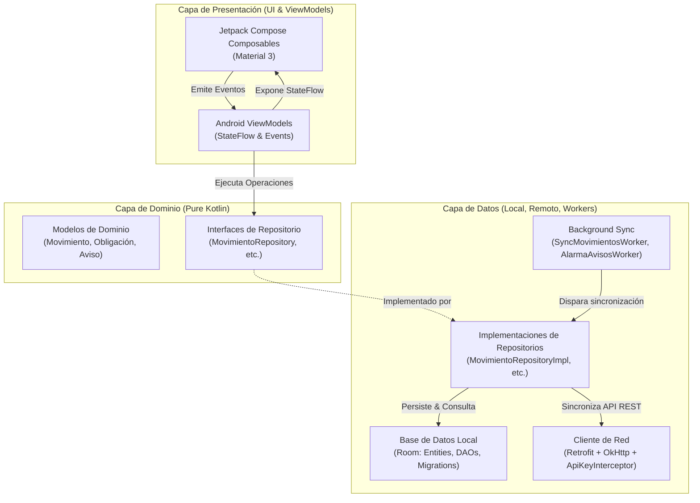

# 🏛️ Arquitectura del Sistema — Gamma Mobile

Este documento detalla los principios de diseño arquitectónico, flujo de datos, modularidad y políticas de seguridad implementadas en **Gamma Mobile**.

---

## 1. Principios Rectores

1. **Clean Architecture (Arquitectura Limpia):** La lógica de negocio (`domain`) es completamente agnóstica a frameworks externos y bibliotecas de Android. La capa de presentación (`presentation`) y de datos (`data`) dependen hacia adentro del dominio, respetando la Regla de Dependencia.
2. **Unidirectional Data Flow (UDF):** El flujo de estado es predecible. La UI emite intenciones/eventos de usuario al `ViewModel`, el `ViewModel` procesa la lógica a través del dominio/datos y emite un `StateFlow` inmutable que la UI observa y renderiza.
3. **Offline-First:** La fuente de la verdad para la UI es la base de datos local persistente (`Room`). La sincronización con el servidor remoto (`PythonAnywhere /api/v1`) ocurre en segundo plano mediante `WorkManager` o bajo demanda.
4. **Seguridad por Diseño (Secure by Design):** Ningún secreto sensible vive en el código fuente. Las comunicaciones en texto plano están restringidas a loopbacks de desarrollo.

---

## 2. Diagrama de Capas



---

## 3. Desglose de Capas

### 3.1. Capa de Presentación (`presentation`)

* **Tecnología:** Jetpack Compose + Material Design 3.
* **Componentes clave:**
  * `dashboard/`: `DashboardScreen`, `DashboardViewModel` (KPIs financieros, balances, margen libre).
  * `transacciones/`: `TransaccionesScreen`, `NuevaTransaccionScreen` (Libro diario y registro asistido por IA).
  * `obligaciones/`: `ObligacionesScreen`, `SimuladorModal` (Gestión de pasivos y simulador crediticio).
  * `asistencia/`: `AsistenciaScreen` (Control de horas y jornadas).
  * `avisos/`: `AvisosScreen` (Alertas del sistema y recordatorios).
  * `sistema/`: `SistemaScreen` (Monitoreo de estado del servidor y canal de actualización in-app de APK).

### 3.2. Capa de Dominio (`domain`)

* **Tecnología:** Kotlin Puro (cero dependencias de Android SDK).
* **Contratos:**
  * Modelos de datos puros e inmutables: `Movimiento`, `Obligacion`, `Aviso`, `HealthStatus`, `DashboardKpi`.
  * Interfaces de repositorio: definen qué operaciones existen sin acoplarse a cómo se almacenan o consultan.

### 3.3. Capa de Datos (`data`)

* **Local (`data/local`):**
  * `GammaDatabase`: Base de datos SQLite gestionada por Room.
  * DAOs: `MovimientoDao`, `ObligacionDao`, `AvisoDao`, `SyncStateDao`.
  * Soporte para transacciones atómicas y queries reactivas mediante `Flow<List<T>>`.
* **Remoto (`data/remote`):**
  * `GammaApi`: Definición de endpoints HTTP de la API REST central (`/api/v1`).
  * `ApiKeyInterceptor`: Inyecta la cabecera `X-API-KEY` de forma transparente en cada llamada.
  * `SafeApiCall`: Encapsula excepciones de red y mapea códigos HTTP a `NetworkResult.Success` o `NetworkResult.Error`.
* **Background Tasks (`data/worker` / `worker`):**
  * `SyncMovimientosWorker`: Sincroniza movimientos pendientes de subida cuando el dispositivo recupera conexión a Internet con constraints de batería.
  * `AlarmaAvisosWorker`: Programa alarmas locales periódicas para alertar al usuario sobre vencimientos críticos de obligaciones.

### 3.4. Inyección de Dependencias (`di`)

* Gestionada integralmente mediante **Hilt**:
  * `AppModule`: Proveedor de dependencias a nivel de aplicación (Dispatchers, Context).
  * `DatabaseModule`: Proveedor de la instancia singleton de `GammaDatabase` y sus DAOs.
  * `NetworkModule`: Configuración del cliente OkHttp, Retrofit y servicios API.

---

## 4. Política de Red y Seguridad

### Configuración de Seguridad de Red (`network_security_config.xml`)

La aplicación aplica una estricta política de protección contra interceptación o fugas de datos:

```xml
<?xml version="1.0" encoding="utf-8"?>
<network-security-config>
    <base-config cleartextTrafficPermitted="false" />
    <domain-config cleartextTrafficPermitted="true">
        <domain includeSubdomains="false">10.0.2.2</domain>
        <domain includeSubdomains="false">localhost</domain>
        <domain includeSubdomains="false">127.0.0.1</domain>
    </domain-config>
</network-security-config>
```

* **Producción:** Todo el tráfico HTTP no cifrado (`cleartext`) está estrictamente prohibido a nivel de sistema operativo.
* **Desarrollo:** Únicamente las IPs de loopback local para emuladores Android están exentas para pruebas locales.

---

## 5. Estrategia de Versionado y Release

* **Version Code:** Calculado dinámicamente o incrementado secuencialmente en `app/build.gradle.kts`.
* **Version Name:** Semántica con hash de commit Git: `MAJOR.MINOR.PATCH+COMMIT` (ej. `0.0.1+3048e4c`).
* **Firma de Release:** Se utiliza el esquema Android APK Signature Scheme v2 con claves resguardadas fuera del repositorio de código.
