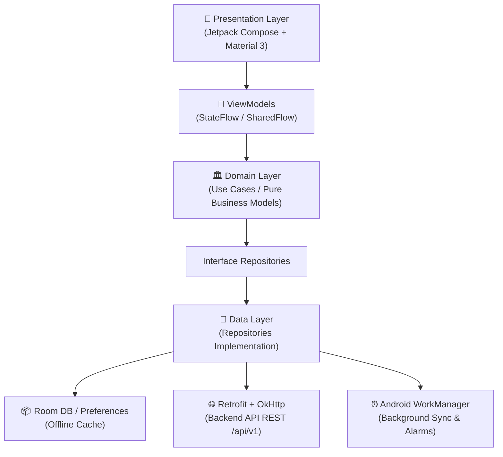

# 📱 Gamma Mobile (Android App)

[-3DDC84?logo=android&logoColor=white)](https://developer.android.com)
[](https://kotlinlang.org)
[](https://developer.android.com/jetpack/compose)
[](ARCHITECTURE.md)
[](.github/workflows/android.yml)
[](https://developer.android.com/topic/libraries/architecture/room)

**Gamma Mobile** es el cliente móvil nativo Android del ecosistema **Gamma**, diseñado para la gestión contable, financiera, operativa y personal multidisciplinaria. Actúa como una interfaz desacoplada de alto rendimiento conectada a la API REST central (`/api/v1`) alojada en PythonAnywhere, garantizando continuidad operativa mediante arquitectura **Offline-First**.

---

## 📑 Tabla de Contenidos

1. [Características Principales](#-características-principales)
2. [Arquitectura y Tecnologías](#-arquitectura-y-tecnologías)
3. [Estructura del Proyecto](#-estructura-del-proyecto)
4. [Seguridad y Gobernanza](#-seguridad-y-gobernanza)
5. [Instalación y Configuración](#-instalación-y-configuración)
6. [Compilación y Testing](#-compilación-y-testing)
7. [Distribución y Releases](#-distribución-y-releases)
8. [Contribución](#-contribución)

---

## ✨ Características Principales

* **📊 Dashboard Ejecutivo:** Visualización en tiempo real del flujo de caja, ingresos, gastos fijos/variables, balance neto, métricas impositivas (IVA) y margen libre mensual.
* **⚡ Libro Diario (Transacciones):** Registro y consulta reactiva de movimientos contables con filtros instantáneos por tipo, cuenta y categoría.
* **🤖 Registro Inteligente con NLP:** Soporte para interpretar entradas en lenguaje natural (texto y voz) y autocompletar categorías y montos asistido por IA.
* **🏦 Gestor de Obligaciones y Simulador Financiero:** Panel de control de deudas y compromisos con un simulador interactivo para evaluar impacto crediticio en el margen mensual antes de asumir nuevos pasivos.
* **🕒 Control de Asistencia:** Marcación y registro de jornada operativa, cómputo de horas y sincronización con el libro de gestión.
* **📢 Avisos y Notificaciones Locales:** Sistema de alertas preventivas programadas (30, 7, 5, 3 y 1 días de anticipación) ejecutadas en segundo plano vía `WorkManager` sin consumo innecesario de datos.
* **🔄 Sincronización Offline-First:** Persistencia local reactiva con `Room Database`. Las transacciones y estados se almacenan localmente y se sincronizan automáticamente con el backend cuando hay conectividad.
* **📲 Canal de Actualizaciones In-App:** Detección de versiones remotas y descarga directa del APK firmado desde la pantalla de Sistema, sin intermediación de tiendas comerciales.

---

## 🛠 Arquitectura y Tecnologías

El proyecto sigue estrictamente los principios de **Clean Architecture** y separación de responsabilidades unidireccional (UDF / MVI-MVVM).



### Stack Técnico

| Área | Tecnología | Propósito |
|---|---|---|
| **Lenguaje** | Kotlin 2.0+ con Coroutines & Flows | Programación asíncrona, segura y reactiva |
| **Interfaz de Usuario** | Jetpack Compose + Material 3 | UI declarativa moderna y responsiva |
| **Inyección de Dependencias** | Hilt (Dagger) | Modularidad y desacoplamiento de componentes |
| **Capa de Red** | Retrofit 2 + OkHttp 4 | Comunicación HTTP con serialización JSON |
| **Persistencia Local** | Room Database + SQLite | Almacenamiento local estructurado y transaccional |
| **Tareas en Background** | Android WorkManager | Tareas en segundo plano confiables con constraints |
| **Build System** | Gradle Kotlin DSL (`.kts`) | Configuración tipada y reproducible del empaquetado |
| **Pruebas** | JUnit 4/5, MockK, Coroutines Test | Verificación rigurosa de ViewModels y Repositorios |

---

## 📁 Estructura del Proyecto

```text
GammaMobile/
├── app/
│   ├── build.gradle.kts                 # Configuración del módulo Android
│   └── src/
│       ├── main/
│       │   ├── AndroidManifest.xml      # Declaración de componentes y permisos
│       │   ├── java/com/gamma/mobile/
│       │   │   ├── data/                # Implementación de datos (Network, Room, Mappers)
│       │   │   │   ├── local/           # Room Database, DAOs, Entities
│       │   │   │   ├── remote/          # Retrofit API, Interceptores, SafeApiCall
│       │   │   │   └── repository/      # Implementaciones concretas de repositorios
│       │   │   ├── di/                  # Módulos Hilt (Network, Database, App)
│       │   │   ├── domain/              # Lógica pura de negocio (Models, Interfaces)
│       │   │   │   ├── model/           # Data classes del dominio
│       │   │   │   └── repository/      # Contratos e interfaces de repositorios
│       │   │   ├── presentation/        # Pantallas Compose y ViewModels
│       │   │   │   ├── asistencia/      # Módulo de control de jornada
│       │   │   │   ├── avisos/          # Módulo de alertas y recordatorios
│       │   │   │   ├── cierre/          # Módulo de balance y cierre contable
│       │   │   │   ├── dashboard/       # Tablero principal de KPIs
│       │   │   │   ├── obligaciones/    # Deudas y simulador de crédito
│       │   │   │   ├── sistema/         # Estado del backend y actualizaciones
│       │   │   │   └── transacciones/   # Libro diario y registro con IA
│       │   │   ├── ui/theme/            # Paleta de colores, tipografía y formas M3
│       │   │   ├── utils/               # Utilidades de formato y fechas
│       │   │   └── worker/              # Workers para sincronización y alarmas
│       │   └── res/
│       │       └── xml/
│       │           └── network_security_config.xml  # Bloqueo estricto de cleartext
│       └── test/                        # Pruebas unitarias de arquitectura
├── docs/                                # Especificaciones y SDD
│   ├── specs/gamma-mobile/              # spec.md, plan.md, tasks.md
│   └── history/                         # Handoffs archivados
├── .github/workflows/                   # Pipelines de integración continua
│   └── android.yml                      # CI para build y pruebas
├── ARCHITECTURE.md                      # Documentación profunda de arquitectura
├── CONTRIBUTING.md                      # Guía de contribución y gobernanza
└── README.md                            # Documento principal
```

---

## 🛡 Seguridad y Gobernanza

1. **Aislamiento de Tráfico HTTP:** La política `network_security_config.xml` prohíbe conexiones en texto claro (`cleartext`) en entornos de producción, admitiéndolas únicamente en loopback local (`10.0.2.2`, `127.0.0.1`, `localhost`) para emuladores de desarrollo.
2. **Autenticación por API Key:** Toda solicitud hacia el backend requiere la cabecera `X-API-KEY`, validada por un interceptor centralizado.
3. **Protección de Secretos:** Llaves criptográficas, keystores (`*.jks`, `*.keystore`) y archivos `local.properties` están explícitamente ignorados en Git y nunca forman parte del código versionado.
4. **Firma V2 Oficial:** Los APKs de release son ensamblados y firmados bajo el esquema V2 mediante `apksigner`.

---

## 🚀 Instalación y Configuración

### Prerrequisitos

* **Android Studio:** Ladybug (2024.2+) o Koala con soporte para Kotlin 2.0.
* **JDK:** Versión 17 (Eclipse Temurin o Amazon Corretto recomendados).
* **Android SDK:** Compile SDK 35, Min SDK 26 (Android 8.0 Oreo).

### Pasos de Configuración

1. **Clonar el repositorio:**
   ```bash
   git clone https://github.com/KEVIN11000/Gamma_Mobile.git
   cd Gamma_Mobile
   ```

2. **Abrir en Android Studio:**
   * Abre la carpeta raíz del proyecto. Espera a que Gradle finalice la sincronización inicial de dependencias.

3. **Configuración de variables locales:**
   * En caso de requerir personalización del endpoint o llaves de desarrollo, configura tu archivo `local.properties`:
     ```properties
     sdk.dir=/ruta/a/tu/Android/sdk
     gamma.api.base_url=https://kevin11000.pythonanywhere.com/
     ```

---

## 🧪 Compilación y Testing

Para compilar y verificar el estado del proyecto desde la terminal:

```bash
# Ejecutar la suite completa de pruebas unitarias
./gradlew testDebugUnitTest

# Compilar el APK de depuración (Debug)
./gradlew assembleDebug

# Generar reporte de análisis estático (Lint)
./gradlew lintDebug

# Compilar el APK optimizado y firmado para producción (Release)
./gradlew assembleRelease
```

---

## 📦 Distribución y Releases

Los binarios de release se empaquetan con ProGuard/R8 habilitado y se distribuyen mediante **GitHub Releases** y el bot central de Telegram (`/app`):

* **Artefacto:** `app-release.apk`
* **Esquema de versión:** Semver `MAJOR.MINOR.PATCH+COMMIT` (ej. `0.0.1+3048e4c`).
* **Verificación de firma:**
  ```bash
  apksigner verify --verbose app/build/outputs/apk/release/app-release.apk
  ```

---

## 🤝 Contribución

Consulta [CONTRIBUTING.md](CONTRIBUTING.md) para detalles sobre nuestro flujo de trabajo, convenciones de commit y gobernanza de código.

---

## 📄 Licencia

Este proyecto forma parte del ecosistema privado **Gamma**. Todos los derechos reservados.
