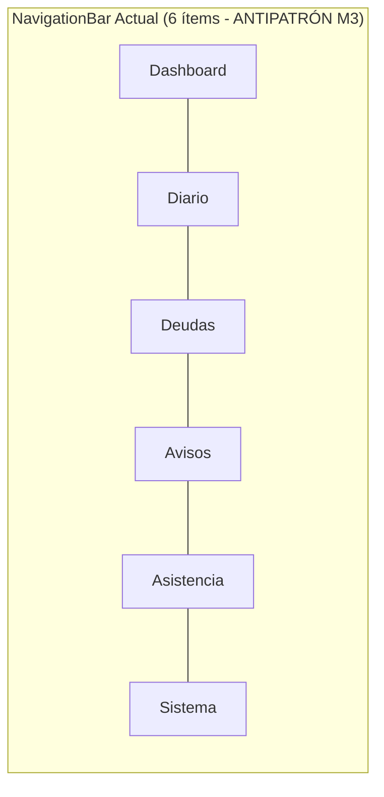
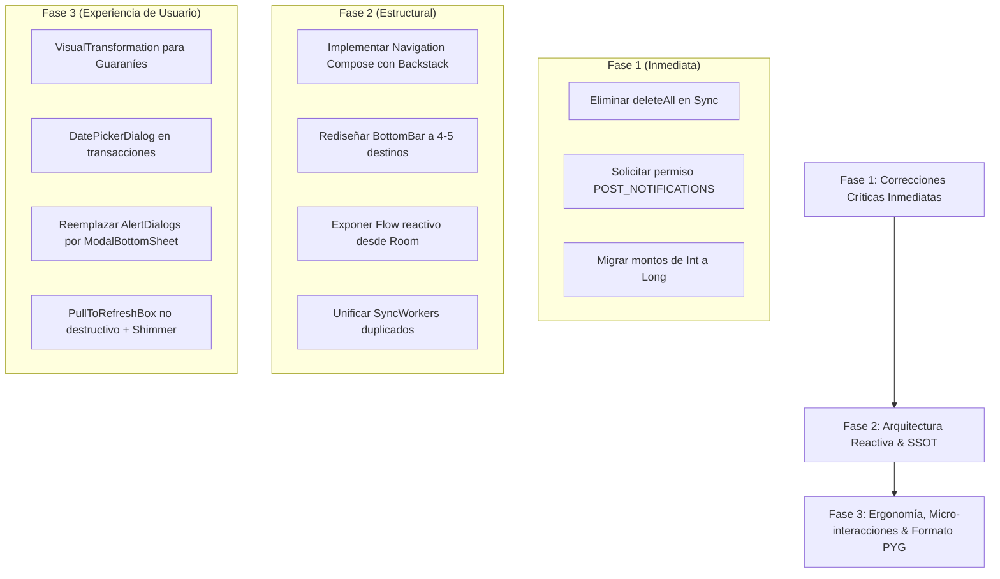

# Auditoría Técnica y Ergonómica de Arquitectura Móvil y UX: Gamma Mobile

**División de Ingeniería:** Mobile App Builder / Agency-Agents  
**Plataforma Auditada:** Android Nativo (Kotlin + Jetpack Compose + Room + Hilt + WorkManager)  
**Ubicación del Código:** `app/src/main/java/com/gamma/mobile/`  
**Fecha:** Octubre 2026  
**Clasificación:** Reporte Técnico Consultivo Enterprise (Advisory)

---

## 1. Resumen Ejecutivo

Gamma Mobile representa un esfuerzo sólido por construir un cliente empresarial para el ecosistema Gamma sobre el stack moderno de Android (Jetpack Compose Material 3, Clean Architecture, Hilt, Room, Retrofit y WorkManager). La aplicación cuenta con módulos clave funcionales: Libro Diario contable, gestión de Obligaciones con simulador de cuotas, Avisos tributarios con procesamiento IA/OCR, Marcación de Asistencia laboral y Cierre mensual con descarga de reportes PDF.

No obstante, la auditoría exhaustiva de la arquitectura y la experiencia de usuario (UX) revela **cuellos de botella críticos de fiabilidad, riesgo latente de pérdida de datos offline, lagunas ergonómicas y violaciones a directrices de Material Design 3**.

### Matriz de Madurez Tecnológica

| Eje Evaluado | Estado Actual | Veredicto | Riesgo Principal |
| :--- | :---: | :---: | :--- |
| **Arquitectura Compose & Navegación** | 🟡 Regular | Requiere Refactor | Sin backstack real, 6 pestañas en BottomBar, ViewModels sin scoped lifecycle. |
| **Room & Persistencia Offline-First** | 🔴 Crítico | Vulnerabilidad Grave | `deleteAll()` en refresco borra transacciones offline pendientes; Flow reactivo no implementado. |
| **Reactividad & Estados de Carga** | 🟡 Regular | Subóptimo | Cargas destructivas (destruyen la vista para mostrar spinner); pantallas de error sin botón de reintento. |
| **Visibilidad del Estado del Sistema** | 🔴 Deficiente | Crítico | Ausencia de indicador de conectividad; `syncStatus` oculto para el usuario; permisos de notificación nunca solicitados en Android 13+. |
| **Formateo Numérico (PYG ₲) & Moneda** | 🔴 Inseguro | Riesgo de Overflow | Uso de `Int` de 32 bits (límite ~2.147M Gs.); instanciación costosa de `NumberFormat`; sin máscara al escribir. |
| **Componentes de Selección (Fechas/Horas)**| 🔴 Deficiente | Incompleto | Fecha hardcodeada a hoy en transacciones; ausencia de M3 DatePicker; array estático de meses para cierres. |
| **Ergonomía Táctil & Micro-interacciones** | 🟡 Regular | Mejorable | Alertas modales comprimidas por teclado virtual; targets táctiles < 48dp; FABs apilados sobre la barra de navegación. |

---

## 2. Auditoría Técnica de Arquitectura: Compose, ViewModels y Room

### 2.1. Navegación, Backstack y Ciclo de Vida de ViewModels

#### Hallazgo: Navegación Manual sin Backstack
En `com/gamma/mobile/MainActivity.kt`:
```kotlin
var currentScreen by remember { mutableStateOf(Screen.Dashboard) }
```
La aplicación no utiliza **Jetpack Navigation Compose** (`NavHost`, `rememberNavController`). La navegación se realiza mutando un estado local `currentScreen`.

* **Impacto en el usuario:**
  1. **Destrucción del flujo al presionar Atrás:** Si el usuario está en *Transacciones*, *Obligaciones*, *Avisos* o *Asistencia* y presiona el botón físico/gestual de "Atrás" de Android, la aplicación se cierra de inmediato (`finish()` de la `MainActivity`), en lugar de regresar a la pantalla anterior o al Dashboard.
  2. **Inconsistencia en pantallas secundarias:** En `NuevaTransaccionScreen`, se provee un callback `onBack = { currentScreen = Screen.Dashboard }`, pero al pulsar el botón atrás del sistema operativo, el usuario sale de la app perdiendo los datos que estaba tipeando, pues no existe un `BackHandler` interceptor.

#### Hallazgo: Instanciación de ViewModels sin NavBackStackEntry
En el bloque `when (currentScreen)` de `MainActivity.kt`:
```kotlin
Screen.Dashboard -> {
    val dashboardViewModel: DashboardViewModel = androidx.hilt.navigation.compose.hiltViewModel()
    DashboardScreen(...)
}
Screen.Transacciones -> {
    val transaccionesViewModel: TransaccionesViewModel = androidx.hilt.navigation.compose.hiltViewModel()
    TransaccionesScreen(...)
}
```
* **Problema:** Al no existir un `NavHost`, `hiltViewModel()` resuelve por defecto el `ViewModelStoreOwner` más cercano en el árbol de composición, que es la propia `MainActivity`.
* **Consecuencia:** Todos los ViewModels quedan atados indefinidamente al ciclo de vida de la actividad principal. No se destruyen cuando el usuario sale de una sección, acumulando memoria y reteniendo suscripciones o estados de búsqueda no deseados.

#### Hallazgo: Flujo de Onboarding Huérfano
Existe un `OnboardingViewModel.kt` en `com/gamma/mobile/presentation/onboarding/` que verifica y almacena la API Key contra `/health`. Sin embargo:
* No existe ningún Composable `OnboardingScreen.kt`.
* `MainActivity` inicia directamente en `Screen.Dashboard`.
* Si la aplicación se instala de cero sin API Key configurada, el usuario choca directamente contra errores de red en el Dashboard, teniendo que navegar a oscuras hasta la pestaña "Sistema" (la última) para configurar su credencial.

---

### 2.2. Room y Persistencia Offline-First: Vulnerabilidades Críticas

#### 🚨 Vulnerabilidad Grave: Borrado Silencioso de Datos Locales Pendientes
En `com/gamma/mobile/data/repository/MovimientoRepositoryImpl.kt` (líneas 39-46):
```kotlin
return when (val response = safeApiCall(dispatcher) { api.getMovimientos() }) {
    is NetworkResult.Success -> {
        val remoteData = response.data
        movimientoDao.deleteAll() // <--- ¡PELIGRO!
        movimientoDao.insertAll(remoteData.map { it.toEntity() })
        syncStateDao.insert(SyncStateEntity(SYNC_KEY, System.currentTimeMillis()))
        NetworkResult.Success(remoteData)
    }
    ...
}
```
Y en `com/gamma/mobile/data/local/dao/MovimientoDao.kt`:
```kotlin
@Query("DELETE FROM movimientos")
suspend fun deleteAll()
```

* **Escenario de desastre real:**
  1. El usuario está sin conexión o con señal débil (muy común en zonas del interior o subsuelos en Paraguay) y registra una transacción de compra de combustible o insumos.
  2. `addMovimiento()` almacena la transacción en Room con `syncStatus = "PENDING"` y encola el `SyncMovimientosWorker`.
  3. El usuario recupera conectividad o hace un refresco manual (`getMovimientos(forceRefresh = true)`).
  4. La API responde con los movimientos previos del servidor.
  5. `movimientoDao.deleteAll()` se ejecuta **incondicionalmente**, eliminando de la base de datos local tanto los movimientos sincronizados como los movimientos con estado `"PENDING"` que aún no habían sido subidos.
  6. **Resultado:** Pérdida silenciosa e irreversible de transacciones financieras creadas offline por el usuario.

* **Solución arquitectónica:**
  Nunca utilizar `deleteAll()` masivo. Se debe implementar `DELETE FROM movimientos WHERE syncStatus = 'SYNCED'` o utilizar estrategias de sincronización basadas en `upsert` donde los registros locales con `syncStatus == 'PENDING'` queden protegidos contra sobreescritura.

#### Hallazgo: Ruptura del Patrón Single-Source-of-Truth (SSOT)
En `MovimientoRepositoryImpl.kt`:
```kotlin
override fun getMovimientosLocal(): Flow<List<Movimiento>> {
    // En un caso real MovimientoDao retornaría Flow<List<MovimientoEntity>>
    throw NotImplementedError("To be implemented as Flow")
}
```
Actualmente, la UI consume datos mediante llamadas puntuales por demanda (`suspend fun getMovimientos()`), en lugar de observar un `Flow<List<Movimiento>>` reactivo emitido por Room. Cuando `SyncMovimientosWorker` procesa exitosamente un movimiento en segundo plano y cambia su estado a `SYNCED`, la pantalla de transacciones no se entera automáticamente a menos que el usuario fuerce un refresco.

#### Hallazgo: Asimetría en la Resiliencia Offline (Obligaciones y Avisos)
* `MovimientoEntity` posee un campo `syncStatus: String`.
* Sin embargo, `ObligacionEntity` y `AvisoEntity` **carecen por completo de seguimiento de sincronización**.
* En `ObligacionRepositoryImpl.kt`:
  ```kotlin
  override suspend fun createObligacion(obligacion: Obligacion): NetworkResult<Unit> {
      val result = safeApiCall(dispatcher) { api.createObligacion(obligacion) }
      if (result is NetworkResult.Success) {
          obligacionDao.insertAll(listOf(obligacion.toEntity()))
      }
      return result
  }
  ```
  Si el usuario no tiene conexión:
  1. La llamada a la API falla.
  2. La entidad **nunca se guarda en Room**.
  3. No se agenda ningún worker de WorkManager.
  4. En el `ObligacionesViewModel`, se realizó una actualización optimista en memoria (`newList`), por lo que el usuario cree que la obligación se guardó. Al reiniciar la app, los datos desaparecen por completo.

#### Hallazgo: Duplicidad y Confusión de Workers
En el proyecto coexisten dos clases idénticamente nombradas en distintos paquetes:
1. `com.gamma.mobile.data.worker.SyncMovimientosWorker`: El worker real que lee `dao.getPendingSync()` y llama a `api.createMovimiento()`.
2. `com.gamma.mobile.worker.SyncMovimientosWorker`: Un archivo huérfano con un mock de notificación.

Tener dos workers homónimos crea riesgo de importaciones cruzadas en Hilt y confunde el mantenimiento técnico.

#### Hallazgo: Ausencia de Gestión de Migraciones en Room
En `DatabaseModule.kt`:
```kotlin
Room.databaseBuilder(context, GammaDatabase::class.java, "gamma_database").build()
```
Y en `GammaDatabase.kt`: `exportSchema = false`.
* No se han definido `Migration` ni se ha configurado `fallbackToDestructiveMigration()` para entornos de prueba.
* En una actualización enterprise futura, cualquier cambio en una columna o tabla provocará un crash instantáneo en producción: `IllegalStateException: Room cannot verify the data integrity`.

---

## 3. Reactividad de la UI, Manejo de Estados y Visibilidad del Sistema

### 3.1. Destrucción de la Vista ante Estados de Carga (Destructive Loading)

En aplicaciones móviles de alta calidad, la regla de oro es: **nunca destruir la información visual que el usuario ya está consultando para mostrar un spinner de pantalla completa**, salvo durante la primera carga en frío.

* **El problema en Dashboard, Transacciones y Avisos:**
  En `DashboardViewModel`:
  ```kotlin
  fun loadDashboard(forceRefresh: Boolean = false) {
      _uiState.value = DashboardUiState.Loading // <--- Destruye el estado actual
      viewModelScope.launch { ... }
  }
  ```
  Al llamar a `loadDashboard()` o `loadAvisos()`, el estado pasa a `Loading`, lo que provoca que en `DashboardScreen`:
  ```kotlin
  when (val state = uiState) {
      is DashboardUiState.Loading -> CircularProgressIndicator(modifier = Modifier.align(Alignment.Center))
      ...
  }
  ```
  Toda la interfaz desaparece (tarjeta de margen libre, posición IVA, lista de eventos), reemplazada por un spinner centrado en blanco. Si la conexión tarda 5 segundos, el usuario experimenta un "parpadeo blanco" molesto e innecesario.
* **El patrón enterprise recomendado:**
  Separar el estado de los datos del estado de actualización:
  ```kotlin
  data class DashboardUiState(
      val summary: DashboardSummary? = null,
      val avisos: List<AvisoUiModel> = emptyList(),
      val isInitialLoading: Boolean = false,
      val isRefreshing: Boolean = false,
      val errorMessage: String? = null
  )
  ```
  El contenido permanece intacto en pantalla mientras una animación sutil o un `PullToRefreshBox` de Material 3 indica la actividad en curso.

---

### 3.2. Pantallas de Error sin Salida (Dead-End Error Traps)

En `DashboardScreen.kt`:
```kotlin
is DashboardUiState.Error -> {
    Column(modifier = Modifier.align(Alignment.Center), ...) {
        Icon(imageVector = Icons.Default.Warning, contentDescription = "Error", ...)
        Spacer(modifier = Modifier.height(8.dp))
        Text(state.message, color = MaterialTheme.colorScheme.error)
        if (state.isOffline) {
            Text("Estás offline. Revisa tu conexión.", style = MaterialTheme.typography.bodySmall)
        }
    }
}
```
* **Diagnóstico UX:** No hay botón de **"Reintentar"** (`Button(onClick = { viewModel.loadDashboard(true) })`).
* Si el teléfono experimenta una pérdida momentánea de paquete o el servidor backend tarda en despertar, el usuario queda atrapado permanentemente en esta pantalla de advertencia sin ninguna forma de recuperarse, a menos que mate el proceso en el sistema operativo.

En `TransaccionesViewModel.kt`:
```kotlin
fun loadMovimientos(forceRefresh: Boolean = false) {
    ...
    when (val result = repository.getMovimientos(forceRefresh)) {
        ...
        is NetworkResult.Exception -> {
            _uiState.value = TransaccionesUiState.Error("Fallo de conexión", isOffline = true)
        }
    }
}
```
* Si el usuario ya estaba viendo 25 transacciones del mes y hace *pull-to-refresh* justo cuando entra a un ascensor o túnel sin señal, **el ViewModel reemplaza las 25 transacciones por la pantalla de error**.
* Se destruye el valor de tener Room: en lugar de mostrar las transacciones cacheadas con un aviso flotante (Snackbar) diciendo *"Sin conexión. Mostrando datos locales"*, se borra la pantalla completa.

---

### 3.3. Visibilidad del Estado del Sistema (Heurística #1 de Nielsen)

1. **Indicador de Conectividad Ausente:**
   El usuario nunca sabe si los datos financieros que observa corresponden a información en vivo sincronizada hace un minuto o a una caché de hace 3 días. No hay timestamp de última sincronización ni un badge ("Modo Offline") en la barra superior.
2. **Estado de Transacciones Locales Oculto:**
   `MovimientoEntity` contiene el campo `syncStatus = "PENDING" | "SYNCED"`, pero en `toDomain()` este dato es descartado:
   ```kotlin
   fun MovimientoEntity.toDomain(): Movimiento = Movimiento(id, fecha, tipo, categoria, total, comprobante)
   ```
   Como resultado, la tarjeta `MovimientoItem` no puede mostrar si el gasto ya está confirmado en el servidor o pendiente en cola. En contabilidad empresarial, esto genera angustia operativa (el usuario no sabe si duplicó una factura al reenviarla).
3. **Carga en Procesamiento IA y OCR Asistido:**
   En `NuevaTransaccionScreen`, la llamada a la IA demora hasta 45 segundos. En la pestaña "IA", el botón *"Interpretar con IA"* no muestra un indicador de carga embebido ni deshabilita el botón mientras dura la petición, permitiendo que el usuario presione repetidamente el botón y lance múltiples peticiones concurrentes a PythonAnywhere (que solo tiene un worker).

---

### 3.4. 🚨 Fallo Crítico de Permisos en Android 13+ (AlarmaAvisosWorker)

En `com/gamma/mobile/worker/AlarmaAvisosWorker.kt`:
```kotlin
if (android.os.Build.VERSION.SDK_INT >= android.os.Build.VERSION_CODES.TIRAMISU) {
    if (ContextCompat.checkSelfPermission(context, android.Manifest.permission.POST_NOTIFICATIONS) != PackageManager.PERMISSION_GRANTED) {
        return // <--- Aborta en silencio
    }
}
```
* **El fallo:** En Android 13 (API 33) y Android 14 (API 34), el permiso `POST_NOTIFICATIONS` es de **tiempo de ejecución** (runtime permission).
* Aunque está declarado en `AndroidManifest.xml`, **ninguna pantalla ni Composable solicita dicho permiso al usuario** (usando `rememberPermissionState` de Accompanist/Compose o `ActivityResultContracts.RequestPermission()`).
* **Consecuencia:** En cualquier dispositivo moderno que ejecute Android 13+, las alarmas y recordatorios de vencimiento de impuestos (30, 7, 5, 3 y 1 días antes) **nunca se mostrarán**. La funcionalidad estrella de avisos tributarios queda 100% inoperativa silenciosamente.

---

## 4. Auditoría Ergonómica, Formateo Numérico y Componentes de Selección

### 4.1. Localización Numérica: Guaraní Paraguayo (PYG ₲)

#### Riesgo de Desbordamiento de Enteros (Integer Overflow)
En todo el dominio y modelo (`Models.kt`, `FormatUtils.kt`, `NuevaTransaccionUiState.kt`):
```kotlin
fun formatGuaranies(amount: Int): String {
    val formatter = NumberFormat.getNumberInstance(Locale("es", "PY"))
    return "${formatter.format(amount)} ₲"
}
```
* **La realidad económica del Guaraní:**
  El Guaraní paraguayo no utiliza centavos y su tasa de cambio oscila alrededor de 1 USD ≈ 7.800 PYG.
  * `Int.MAX_VALUE` en Kotlin/Java es `2.147.483.647` (~2.147 millones de Guaraníes).
  * 2.147 millones de Gs. equivale a apenas **~275.000 USD**.
  * Una empresa mediana, un profesional independiente con balances acumulados, o la compra de un vehículo/inmueble comercial supera con facilidad los 2.147 millones de Gs.
  * Si un usuario tiene un saldo o registra un movimiento de `2.200.000.000 ₲`, ocurre un **overflow aritmético silencioso** y el valor pasa a ser negativo (`-2.094.967.296 ₲`), destruyendo por completo la integridad de los cálculos del libro contable y la posición del IVA.
* **Solución requerida:** Todos los campos monetarios deben tiparse como `Long` (o `BigDecimal` para bases imponibles complejas).

#### Rendimiento y Lag de UI (Jank en LazyColumn)
`NumberFormat.getNumberInstance(Locale("es", "PY"))` es una operación de inicialización pesada que lee tablas de localización y patrones de formato del sistema.
* En `formatGuaranies()`, se instancia un nuevo objeto `NumberFormat` **en cada llamada individual**.
* En `TransaccionesScreen`, una lista con 50 o 100 items que se scrollea a 60/120 Hz invoca `formatGuaranies` decenas de veces por segundo, produciendo continuas reservas de memoria en el heap y activando pausas de recolección de basura (Garbage Collection jank).
* **Solución:** Cachear la instancia del formateador o usar `ThreadLocal` / objeto singleton inmutable.

#### Entrada de Texto sin Separador de Miles en Tiempo Real
En `NuevaTransaccionScreen.kt`:
```kotlin
OutlinedTextField(
    value = uiState.totalInput,
    onValueChange = { viewModel.updateTotal(it) },
    label = { Text("Monto Total (IVA Incluido, ₲)") },
    keyboardOptions = KeyboardOptions(keyboardType = KeyboardType.Number),
    modifier = Modifier.fillMaxWidth()
)
```
* Al escribir, el usuario ve una cadena cruda: `15000000`.
* **Problema cognitivo grave:** En una moneda de denominaciones elevadas como el Guaraní, es humanamente imposible distinguir a simple vista si `15000000` son 1.500.000 (un millón y medio) o 15.000.000 (quince millones). La tasa de error del usuario al tipear ceros es sumamente alta.
* **Solución:** Implementar un `VisualTransformation` nativo de Compose que inserte puntos separadores de miles de forma automática (`15.000.000 ₲`) mientras el usuario tipea dígitos limpios, acompañado de chips rápidos de adición (`+10.000`, `+50.000`, `+100.000`, `+1.000.000`).

---

### 4.2. Componentes de Selección: Fechas, Horas y Períodos

#### 1. Fecha de Transacción Hardcodeada a "Hoy"
En `NuevaTransaccionViewModel.kt`:
```kotlin
val today = LocalDate.now(clock).format(DateTimeFormatter.ofPattern("yyyy-MM-dd"))
val movimiento = Movimiento(..., fecha = today, ...)
```
* **Falla de usabilidad fundamental:** No existe selector de fecha en la pantalla de nueva transacción. La fecha se asigna irrevocablemente al día de hoy.
* Si el profesional o comerciante carga una factura emitida el fin de semana pasado o hace dos semanas, el sistema no le permite elegir la fecha real del comprobante, distorsionando la declaración fiscal mensual del IVA.
* **Solución:** Integrar el componente Material 3 `DatePickerDialog` o un campo editable con fecha formateada en español (`"24 de Octubre de 2026"`).

#### 2. Fragilidad en el Parseo de Fechas en `AvisoUiMapper`
En `AvisoUiMapper.kt`:
```kotlin
val formatter = DateTimeFormatter.ofPattern("dd/MM/yyyy HH:mm")
val eventDate = try {
    LocalDate.parse(this.fechaEvento, formatter)
} catch (e: Exception) {
    return null // Formato inválido
}
```
* `LocalDate.parse` espera una fecha pura. Al parsear un patrón que incluye horas y minutos (`HH:mm`) sin convertirlo a `LocalDateTime` primero, el método falla en diversas versiones de runtime de Android lanzando `DateTimeParseException`. Como el bloque atrapa la excepción y retorna `null`, **los avisos quedan completamente filtrados y no aparecen en el Dashboard**.
* Además, los avisos en `AvisosScreen` muestran la fecha como texto crudo sin formato amigable ni distinción de vencimiento inminente.

#### 3. Períodos de Cierre con Array Estático de 2026
En `CierreViewModel.kt`:
```kotlin
val periodosDisponibles: List<String> = listOf(
    "Enero 2026", "Febrero 2026", ..., "Diciembre 2026"
)
```
* Hardcodear un array estático con los meses del año 2026 significa que el 1 de enero de 2027 la aplicación quedará obsoleta y requerirá un despliegue de emergencia en Google Play para añadir los períodos subsiguientes.
* La lista de períodos disponibles debe ser provista por la API o computada dinámicamente según el año fiscal en curso.

---

### 4.3. Ergonomía Táctil y Directrices de Material Design 3

#### 1. Sobrecarga en la Barra de Navegación Inferior (NavigationBar)
En `MainActivity.kt`, el `NavigationBar` contiene **6 destinos**:
`Dashboard`, `Diario`, `Deudas`, `Avisos`, `Asistencia`, `Sistema`.



* **Violación de Material Design 3:** Las directrices oficiales de Android y Material 3 establecen taxativamente:
  > *"Navigation bar destinations should range from three to five. Do not use more than five destinations in a navigation bar."*
* **Problema:** En dispositivos con pantallas de 360dp a 390dp de ancho (la mayoría de los teléfonos gama media en la región), 6 botones comprimen el ancho a menos de 55dp por pestaña. Los textos se truncan (`Asistenc...`), los iconos quedan pegados y la probabilidad de toque accidental (*fat-finger error*) se dispara exponencialmente.

#### 2. Violación de Tamaños Mínimos de Toque (< 48x48 dp)
* En `NuevaTransaccionScreen.kt`:
  ```kotlin
  Row {
      RadioButton(selected = uiState.tipo == "Gasto", onClick = { viewModel.updateTipo("Gasto") })
      Text("Gasto", modifier = Modifier.align(Alignment.CenterVertically))
  }
  ```
  El target táctil está restringido al círculo de 20dp del `RadioButton`. El texto adyacente no es cliqueable. El usuario tiene que apuntar con precisión quirúrgica a la pequeña burbuja.
  * **Solución M3:** Reemplazar por `SingleChoiceSegmentedButtonRow` con `SegmentedButton`, que abarca el 100% del ancho con feedback visual y táctil.

#### 3. Botones Flotantes Apilados (Stacked FABs)
En `ObligacionesScreen.kt`:
```kotlin
floatingActionButton = {
    Column(horizontalAlignment = Alignment.End, verticalArrangement = Arrangement.spacedBy(8.dp)) {
        ExtendedFloatingActionButton(...) { Text("Simular Cuota") }
        FloatingActionButton(onClick = { showCrearModal = true }) { ... }
    }
}
```
* Colocar dos FABs (uno extendido y uno normal) apilados verticalmente en la esquina inferior derecha genera un bloque invasivo de casi 130dp de altura justo por encima de la barra de navegación. Esto tapa los últimos elementos de la `LazyColumn` y dificulta el scroll con una sola mano.

#### 4. Diálogos Modales vs Bottom Sheets
En `ObligacionesScreen.kt`, formularios complejos como `CrearObligacionModal`, `AbonarModal` y `SimuladorCuotasModal` están implementados con `AlertDialog`.
* En pantallas estándar de Android, cuando se despliega el teclado numérico/alfanumérico, el `AlertDialog` queda aplastado en el centro, ocultando los botones de confirmar/cancelar o requiriendo scrolls extraños dentro del diálogo.
* **Estándar Enterprise:** Formularios de entrada deben presentarse en un `ModalBottomSheet` con soporte nativo de insets (`Modifier.imePadding()`), respetando la zona de alcance natural del pulgar en uso a una mano.

---

## 5. Recomendaciones Concretas y Plan de Acción Enterprise

Para elevar Gamma Mobile al estándar de excelencia enterprise (cero jank, resiliencia total offline y ergonomía nativa premium), se presenta la siguiente hoja de ruta estructurada en tres fases:



---

### 5.1. Fase 1: Correcciones Críticas de Fiabilidad y Datos

1. **Eliminar el borrado indiscriminado en `MovimientoRepositoryImpl`:**
   * Sustituir `movimientoDao.deleteAll()` por un query selectivo o reemplazo con clave primaria:
     ```kotlin
     @Query("DELETE FROM movimientos WHERE syncStatus = 'SYNCED'")
     suspend fun deleteSyncedOnly()
     ```
   * Al refrescar con el backend, conservar todos los registros locales con `syncStatus = 'PENDING'`.

2. **Migrar todos los campos de moneda de `Int` a `Long`:**
   * Cambiar `total: Long`, `saldoActual: Long`, `montoInicial: Long`, `margenLibreDisponible: Long` en todas las entidades, modelos de dominio y DTOs de Retrofit.
   * Evita desbordamientos silenciosos en balances comerciales que superen los 2.147 millones de Guaraníes.

3. **Solicitar el permiso `POST_NOTIFICATIONS` en runtime (Android 13+):**
   * En `AvisosScreen` o en el flujo de inicio, verificar y solicitar el permiso:
     ```kotlin
     val permissionLauncher = rememberLauncherForActivityResult(
         contract = ActivityResultContracts.RequestPermission()
     ) { isGranted ->
         if (!isGranted) { /* Mostrar banner explicativo */ }
     }
     LaunchedEffect(Unit) {
         if (Build.VERSION.SDK_INT >= Build.VERSION_CODES.TIRAMISU) {
             permissionLauncher.launch(Manifest.permission.POST_NOTIFICATIONS)
         }
     }
     ```

4. **Eliminar la duplicidad de Workers:**
   * Eliminar el stub `com.gamma.mobile.worker.SyncMovimientosWorker` y consolidar toda la lógica en `com.gamma.mobile.data.worker.SyncMovimientosWorker`.

---

### 5.2. Fase 2: Modernización Arquitectural y Flujo de Navegación

1. **Migración a Jetpack Navigation Compose con Backstack Real:**
   * Reemplazar la variable de estado `currentScreen` por un `NavHost`:
     ```kotlin
     val navController = rememberNavController()
     Scaffold(
         bottomBar = { AppBottomNavigation(navController) }
     ) { padding ->
         NavHost(navController = navController, startDestination = "dashboard", modifier = Modifier.padding(padding)) {
             composable("dashboard") { DashboardScreen(...) }
             composable("transacciones") { TransaccionesScreen(...) }
             composable("nueva_transaccion") { NuevaTransaccionScreen(...) }
             composable("obligaciones") { ObligacionesScreen(...) }
             composable("avisos") { AvisosScreen(...) }
             composable("mas") { MasMenuScreen(...) } // Agrupa Asistencia y Sistema
         }
     }
     ```
   * Habilita de inmediato el botón físico "Atrás", preserva el estado del scroll y gestiona el ciclo de vida de los ViewModels vía `NavBackStackEntry`.

2. **Reestructuración de la Barra de Navegación a 4 Destinos Principales:**
   * **Pestaña 1:** Dashboard (Resumen ejecutivo y margen libre).
   * **Pestaña 2:** Diario (Movimientos contables y filtros).
   * **Pestaña 3:** Deudas (Obligaciones y simulador).
   * **Pestaña 4:** Avisos (Agenda tributaria e impuestos).
   * **Pestaña 5:** Más / Menú (Marcación de asistencia laboral, cierre de mes, estado de salud del sistema, soporte y configuración de API Key).
   * Cumple al 100% las directrices ergonómicas de Material 3 y evita toques accidentales.

3. **Arquitectura Reactiva Single-Source-of-Truth con Room:**
   * Los DAOs deben retornar `Flow<List<MovimientoEntity>>`.
   * El repositorio expone `fun getMovimientosStream(): Flow<List<Movimiento>> = dao.getAllFlow().map { it.map { e -> e.toDomain() } }`.
   * Las peticiones de red simplemente escriben en Room. Room notifica a los ViewModels de forma automática y reactiva.

---

### 5.3. Fase 3: Excelencia UX, Ergonomía y Formateo Localizado

1. **Formateador Optimizado y Máscara de Moneda en Tiempo Real (`VisualTransformation`):**
   * Crear un `CurrencyVisualTransformation` para Compose que formatee automáticamente con puntos de miles mientras el usuario escribe:

```kotlin
// Referencia técnica de implementación recomendada para FormatUtils.kt
package com.gamma.mobile.utils

import androidx.compose.ui.text.AnnotatedString
import androidx.compose.ui.text.input.OffsetMapping
import androidx.compose.ui.text.input.TransformedText
import androidx.compose.ui.text.input.VisualTransformation
import java.text.DecimalFormat
import java.text.DecimalFormatSymbols
import java.util.Locale

object GuaraniFormatter {
    private val symbols = DecimalFormatSymbols(Locale("es", "PY")).apply {
        groupingSeparator = '.'
    }
    private val formatter = DecimalFormat("#,###", symbols)

    fun format(amount: Long): String {
        return "₲ ${formatter.format(amount)}"
    }
}

class GuaraniVisualTransformation : VisualTransformation {
    override fun filter(text: AnnotatedString): TransformedText {
        val raw = text.text
        if (raw.isEmpty()) return TransformedText(AnnotatedString(""), OffsetMapping.Identity)
        
        val parsed = raw.toLongOrNull() ?: 0L
        val formatted = GuaraniFormatter.format(parsed)

        val offsetMapping = object : OffsetMapping {
            override fun originalToTransformed(offset: Int): Int = formatted.length
            override fun transformedToOriginal(offset: Int): Int = raw.length
        }
        return TransformedText(AnnotatedString(formatted), offsetMapping)
    }
}
```

2. **Chips Rápidos de Denominación para Carga Eficiente de Gastos:**
   En `NuevaTransaccionScreen`, justo debajo del campo de monto, ofrecer chips para acelerar el ingreso de cifras comunes en Paraguay:
   * `[ +10.000 ]` `[ +50.000 ]` `[ +100.000 ]` `[ +500.000 ]` `[ +1.000.000 ]`
   * Permite cargar gastos cotidianos (combustible, almuerzo, peaje) con un par de toques sin teclear números extensos.

3. **Selector de Fecha Nativo de Material 3 (`DatePicker`):**
   * Permitir la selección explícita de fecha en transacciones pasadas utilizando `DatePickerDialog` o `rememberDatePickerState()`.
   * Presentar la fecha seleccionada en formato localizado natural: `"Hoy, 14 de Octubre de 2026"`.

4. **Reemplazo de Diálogos por `ModalBottomSheet` con Soporte de Teclado:**
   * Migrar los modales de "Crear Deuda", "Abonar" y "Simulador de Cuotas" de `AlertDialog` a `ModalBottomSheet`:
     ```kotlin
     ModalBottomSheet(
         onDismissRequest = onDismiss,
         sheetState = rememberModalBottomSheetState(skipPartiallyExpanded = true),
         modifier = Modifier.imePadding() // Eleva el contenido automáticamente cuando sube el teclado
     ) {
         // Formulario ergonómico en la mitad inferior de la pantalla
     }
     ```

5. **Retroalimentación Háptica en Acciones Financieras:**
   * Al registrar exitosamente un gasto, abonar una cuota o marcar asistencia laboral, invocar:
     ```kotlin
     val haptic = LocalHapticFeedback.current
     haptic.performHapticFeedback(HapticFeedbackType.LongPress)
     ```
   * Proporciona confirmación táctil de que la operación contable quedó asentada de forma concluyente.

---

## 6. Conclusión y Veredicto Consultivo

Gamma Mobile posee un núcleo funcional de gran valor de negocio y una correcta separación conceptual de capas (Clean Architecture con Repository Pattern y Dagger Hilt). Sin embargo, para operar en un entorno de producción enterprise sin fallas ni fricciones operativas, **es mandatorio resolver prioritariamente la vulnerabilidad de pérdida de datos en `MovimientoRepositoryImpl`, migrar los tipos monetarios a `Long` e implementar la solicitud en runtime de las notificaciones de Android 13+**.

Adoptar las directrices de navegación con backstack real, el patrón reactivo de Room con `Flow` y los componentes de formato localizado para el Guaraní paraguayo transformará Gamma Mobile en una aplicación con **calidad nativa impecable, cero jank y máxima confianza para el usuario final**.
