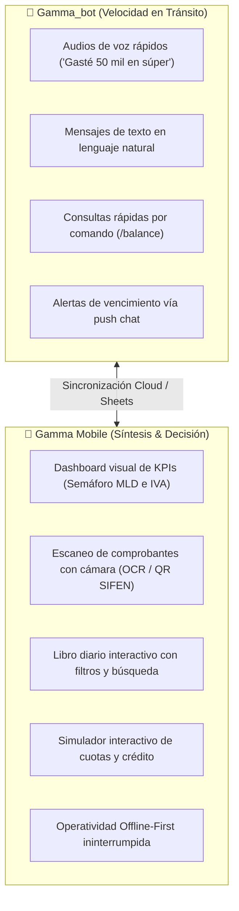
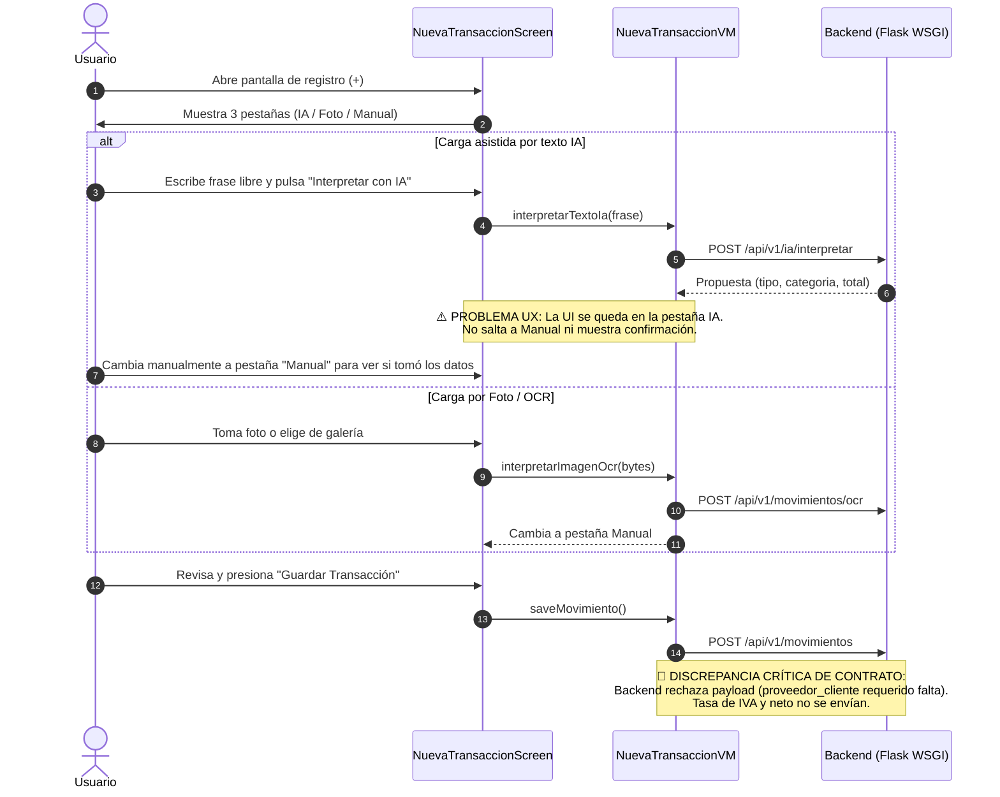
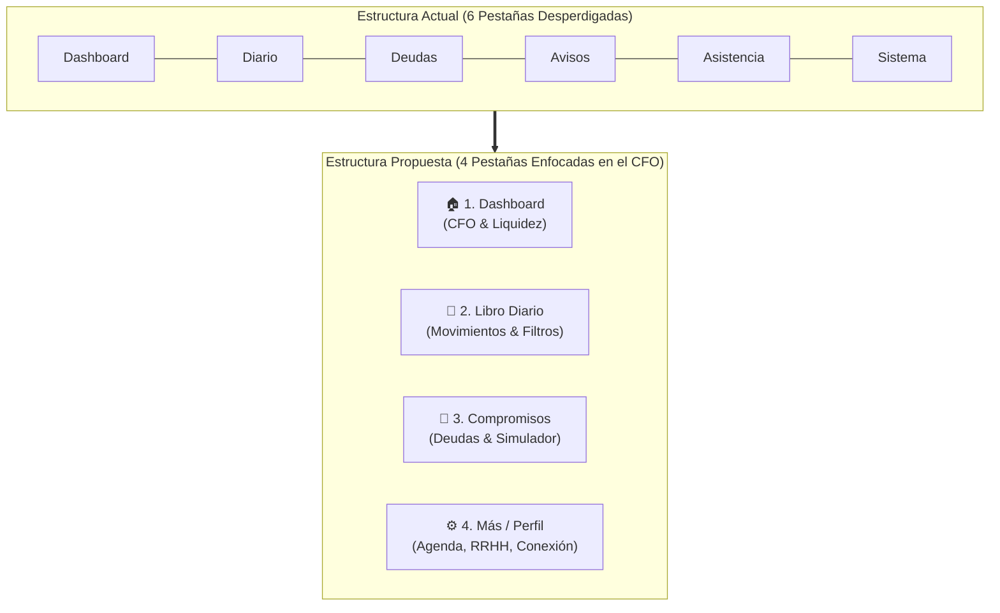
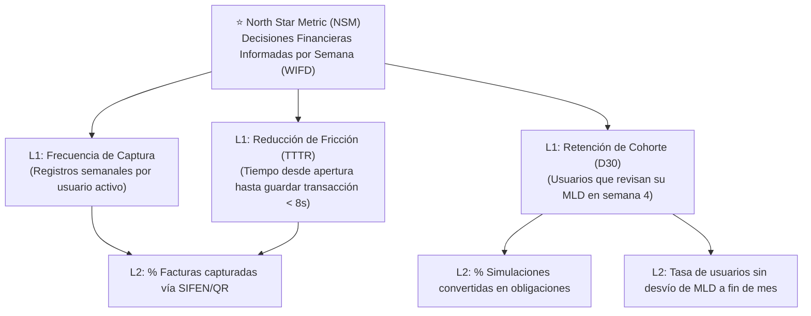

# 📊 Auditoría Estratégica de Producto — Gamma Mobile
**Perspectiva de Producto (Product Division / Agency Agents)**  
**Lead:** Alex, Senior Product Manager  
**Fecha:** Octubre 2026 | **Versión evaluada:** Gamma Mobile v0.0.2 / Backend Blueprint v1  
**Target:** Micro, Pequeñas Empresas (PyMEs) y Profesionales Independientes en Paraguay  

---

## 📑 Índice
1. [Resumen Ejecutivo y Diagnóstico Global](#1-resumen-ejecutivo-y-diagnóstico-global)
2. [Alineamiento Estratégico: "CFO en el Bolsillo para Paraguay"](#2-alineamiento-estratégico-cfo-en-el-bolsillo-para-paraguay)
3. [Auditoría Detallada de User Journeys y Flujos Críticos](#3-auditoría-detallada-de-user-journeys-y-flujos-críticos)
4. [Rediseño de Arquitectura de Información y Ergonomía](#4-rediseño-de-arquitectura-de-información-y-ergonomía)
5. [Matriz de Priorización de Roadmap (MoSCoW / RICE)](#5-matriz-de-priorización-de-roadmap-moscow--rice)
6. [Árbol de Métricas de Producto y Retención](#6-árbol-de-métricas-de-producto-y-retención)
7. [Recomendaciones Operativas para los Próximos Sprints](#7-recomendaciones-operativas-para-los-próximos-sprints)

---

## 1. Resumen Ejecutivo y Diagnóstico Global

### 1.1. La Tesis del Producto
Gamma nació con una promesa transformadora: **convertirse en el Director Financiero (CFO) personal y PyME definitivo en el mercado paraguayo**. 
A diferencia de las aplicaciones tradicionales de finanzas personales (Spendee, Monefy, Mobills, QuickBooks), las cuales operan como meros libros de registro retrospectivo ("dónde gastaste el mes pasado"), el usuario paraguayo (unipersonales con IRE Simple/Resimple, profesionales independientes y emprendedores) opera en un entorno de alta asimetría de liquidez y presión tributaria inmediata de la DNIT (ex-SET).

El valor nuclear de Gamma descansa en tres pilares predictivos y de control:
1. **Margen Libre Disponible (MLD):** Saber exactamente cuánto dinero operativo puede gastar hoy sin comprometer pagos fijos de fin de mes ni cuotas de deuda.
2. **Posición de IVA en Tiempo Real:** Eliminar el pánico del día 20 del mes calculando Débito Fiscal vs. Crédito Fiscal deducible al momento de cada compra.
3. **Simulador de Viabilidad de Pasivos:** Tomar decisiones racionales de endeudamiento antes de asumir nuevas cuotas comerciales o personales.

### 1.2. El Diagnóstico "Brutal Truth"
Tras auditar el código fuente, la experiencia de usuario (UX/UI), el flujo de navegación de `Gamma Mobile` (Android Jetpack Compose) y los contratos de datos de `Gamma_bot` (API Blueprint Flask en PythonAnywhere), la conclusión ejecutiva es:

> **El producto tiene una arquitectura técnica sólida (Clean Architecture, Offline-first con Room, MVI-MVVM), pero sufre de una crisis de identidad funcional y fricción crítica en el bucle principal de valor.**

| Dimensión | Puntuación (1-5) | Diagnóstico PM |
|---|:---:|---|
| **Claridad de la Propuesta de Valor** | ⭐⭐⭐ (3/5) | Los conceptos (MLD e IVA) son estelares, pero se diluyen por exceso de features auxiliares (RRHH, Sysadmin). |
| **Ergonomía y Velocidad de Captura** | ⭐⭐ (2.5/5) | El registro manual es funcional pero lento; el flujo de IA carece de retroalimentación inmediata y el OCR no cierra el ciclo. |
| **Precisión Financiera (Backend)** | ⭐⭐ (2/5) | El backend simula/mockea métricas críticas (IVA en 0, MLD aproximado); existe discrepancia en el schema de persistencia. |
| **Arquitectura de Información (IA)** | ⭐⭐ (2/5) | 6 pestañas en la barra inferior (BottomNav); leak de conceptos técnicos/DevOps (logs, endpoints) al usuario final. |
| **Potencial de Retención** | ⭐⭐⭐⭐ (4/5) | Altísimo si resuelve la angustia tributaria paraguaya y el timing de caja semanal mediante alertas proactivas. |

---

## 2. Alineamiento Estratégico: "CFO en el Bolsillo para Paraguay"

### 2.1. El Contexto Específico Paraguayo (Jobs To Be Done)
El ecosistema financiero en Paraguay posee particularidades que las apps internacionales ignoran por completo:
* **Régimen Tributario (Ley 6380/19):** El IVA no es un detalle estético; es el regulador de caja mensual. Discriminar entre **IVA 10%** (general), **IVA 5%** (canasta familiar, alquileres, salud/medicamentos) y **Exento**, junto con la validez del comprobante (**Virtual Legal**, **Física Legal** vs. **No Legal / Recibo común**), determina si el gasto genera crédito fiscal o dinero perdido.
* **Flujos de Efectivo y SIPAP:** Las transacciones bancarias 24/7 (SIPAP) y pagos QR coexisten con un alto volumen de efectivo informal. El usuario no puede esperar a sentarse frente a una computadora al cierre de mes para conciliar.
* **Presión de Deudas Concentradas:** En PyMEs familiares y profesionales, el crédito comercial (financieras, cooperativas, bancos) es intensivo. Si no hay control de amortización, el flujo de caja colapsa.

### 2.2. Dicotomía Estratégica: Gamma_bot (Telegram) vs. Gamma Mobile (App)
Una app móvil no debe competir contra el bot de Telegram en su propio terreno; debe complementarlo donde el bot tiene un techo de cristal ergonómico.



* **El Rol del Bot:** Entrada rápida de voz y alertas push conversacionales mientras el usuario maneja o camina.
* **El Rol de la App:** Centro de comando visual, análisis táctico, toma de decisiones crediticias complejas y registro fotográfico estructurado con validación fiscal.

### 2.3. ¿Vamos bien encaminados?
* **Acierto mayúsculo:** La elección del stack móvil (Kotlin 2.0, Jetpack Compose Material 3, Room, WorkManager) y la filosofía *Offline-First*. En Paraguay, la cobertura móvil oscila rápidamente entre 4G y zonas de sombra de conectividad; que la app abra instantáneamente y guarde transacciones localmente es un diferencial competitivo vital.
* **Desviación crítica de foco:** La app incorporó módulos de soporte operativo ajenos a la propuesta de valor del CFO (marcado de asistencia laboral y materias universitarias). Esto genera fricción cognitiva y confunde el posicionamiento de mercado.

---

## 3. Auditoría Detallada de User Journeys y Flujos Críticos

### 3.1. User Journey 1: Registro Rápido de Gastos / Ingresos (Input Loop)
El bucle más frecuente del usuario (de 3 a 8 veces al día). Si este flujo tarda más de 10 segundos o genera dudas, la app es abandonada en menos de 2 semanas.



#### Fricciones Identificadas en el Flujo de Entrada:
1. **Ruptura de Feedback en el Tab "IA":**
   * Cuando el usuario pulsa "Interpretar con IA", los campos del ViewModel se actualizan internamente, pero la pantalla **permanece fija en la pestaña de texto** sin ninguna transición ni indicador de éxito. El usuario no sabe si funcionó hasta que intuitivamente pulsa la pestaña "Manual".
2. **Discrepancia Fatal de Contratos de Datos (Bloqueante):**
   * El modelo de dominio `Movimiento` en Android (`Models.kt`) define únicamente: `id`, `fecha`, `tipo`, `categoria`, `total`, `comprobante`.
   * El endpoint del backend (`/api/v1/movimientos`) exige mediante Pydantic (`MovimientoCreate` en `schemas.py`) el campo `proveedor_cliente: str` como obligatorio (sin default) y espera la clave `movimiento` en vez de `tipo`.
   * Además, la selección de `tasa_iva` ("10%", "5%", "Exento") realizada por el usuario en `NuevaTransaccionScreen` **se pierde completamente** al instanciar el objeto `Movimiento` en `NuevaTransaccionViewModel.kt` (líneas 157-164).
   * **Impacto:** Cualquier intento de guardar un movimiento desde la app falla con error 400 de validación o descarta el impacto fiscal en el servidor.
3. **Ausencia del Factor 10x para Paraguay: Escaneo de Factura Electrónica (SIFEN / e-Kuatia):**
   * Actualmente se depende de OCR mediante Gemini (procesamiento pesado de imagen vía WSGI). En Paraguay, toda factura electrónica y auto-impresor fiscal cuenta por ley con un **código QR de control DNIT** (`https://ekuatia.set.gov.py/consultas/qr?...`).
   * Escanear dicho código con la cámara decodifica instantáneamente: RUC emisor, razón social, fecha, número de comprobante, total exacto y liquidación discriminada de IVA 10% y 5% en **menos de 200 milisegundos**, sin costo de tokens de IA ni latencia de red.

---

### 3.2. User Journey 2: Visualización de Margen Libre y Posición de IVA (Decision Making)
El momento en que el usuario abre la app para responder: *"¿Puedo hacer este gasto?"* o *"¿Cómo vengo con mis impuestos este mes?"*.

#### Análisis del Dashboard Actual (`DashboardScreen.kt`):
* **Falso Estado Vacío (Heuristic Flaw):**
  * En `DashboardViewModel.kt` (línea 49):
    ```kotlin
    if (summaryResult.data.saldoAcumulado == 0 && summaryResult.data.margenLibreDisponible == 0) {
        _uiState.value = DashboardUiState.Empty
    }
    ```
  * Si un usuario que recién comienza tiene saldo 0 o si su margen libre calculado momentáneamente da 0, la app oculta todo el Dashboard y muestra un mensaje plano: *"No hay datos registrados aún"*. El usuario no puede ver sus gastos del mes ni su posición de IVA.
* **Métricas Omitidas en la Interfaz:**
  * La especificación funcional (`spec.md` 5.1) exige: Margen libre, saldo acumulado, posición IVA, ingresos del mes, gastos del mes y flujo neto.
  * En la UI real solo se dibujan dos valores: Margen Libre y Posición IVA. Se omitieron el Saldo Acumulado, el Total Ingresos y el Total Gastos, dejando al usuario a ciegas sobre su volumen transaccional mensual.
* **Simulación en el Backend:**
  * En el backend (`blueprint.py`, líneas 84-118), la `posicion_iva` se encuentra **hardcodeada en 0** y `es_debito_fiscal: False`. El `margen_libre` se estima con una regla improvisada (`flujo_neto - gastos * 0.2`) en lugar de restar las obligaciones maestras y el presupuesto base.
  * **Impacto:** El "CFO" hoy está mostrando datos ficticios al usuario. La confianza se destruye de inmediato cuando el usuario compara la app con su extracto bancario.

---

### 3.3. User Journey 3: Gestión de Deudas y Simulador Crediticio (Risk Management)
La funcionalidad más innovadora del producto: evaluar el impacto de un nuevo pasivo antes de endeudarse.

#### Evaluación de `ObligacionesScreen.kt` y `SimuladorModal.kt`:
* **Aciertos:**
  * El semáforo de riesgo (Verde / Amarillo / Rojo) en el modal de simulación es un acierto rotundo de UX; comunica instantáneamente si la cuota cabe dentro del Margen Libre.
  * La barra de progreso visual de amortización en cada tarjeta de deuda (`LinearProgressIndicator`) otorga una gratificante sensación de avance financiero.
* **Fricciones y Oportunidades:**
  * **FABs Apilados:** Como se detectó en el reporte heurístico, tener dos botones flotantes ("Simular Cuota" y "+") genera confusión visual y penaliza la ergonomía en una sola mano.
  * **Desconexión entre Simulación y Realidad:** El simulador diagnostica la viabilidad, pero no ofrece el botón "Aprobar y Crear Obligación". Si la simulación es viable, el usuario tiene que cerrar el modal, abrir el modal de creación y volver a tipear todos los datos a mano.
  * **Amortización sin Vínculo Contable:** Al pulsar "Abonar", se abre un cuadro de diálogo para registrar el monto, pero no permite seleccionar la cuenta de salida (Efectivo, Banco, Caja Chica) ni discriminar si incluye intereses o amortización pura de capital.

---

### 3.4. User Journey 4: Avisos, Notificaciones y Soporte

#### Ruido Cognitivo y Desviación de Dominio:
* **Mezcla de Agendas:** La pestaña `Avisos` lista eventos de Google Calendar. En la práctica actual, mezcla vencimientos de cuotas de crédito con recordatorios personales e hitos de materias académicas.
* **Alertas sin Contexto Financiero:** Un aviso financiero de alto valor debe ser: *"Vence tu cuota de Itaú (₲ 850.000) en 48 hs. Tu margen libre restante cubrirá el 100%"*. Un aviso genérico ("Revisar pago") no genera acción informada.
* **Pestaña `Sistema` en Barra Inferior Principal:**
  * En `MainActivity.kt`, la barra de navegación tiene 6 ítems: `Dashboard`, `Diario`, `Deudas`, `Avisos`, `Asistencia`, `Sistema`.
  * La pantalla `Sistema` expone: selector de URL de backend, visualización de API Key, estado del worker WSGI y **lectura de logs de depuración del servidor**.
  * **Veredicto PM:** Esto es una herramienta de debugging para ingenieros, no una función para un dueño de PyME. Su presencia en la barra principal resta credibilidad profesional y sobrecarga la navegación móvil.

---

## 4. Rediseño de Arquitectura de Información y Ergonomía

### 4.1. De 6 Pestañas a 4 Pestañas Nucleares (Eliminación de la Congestión Móvil)
El estándar de usabilidad de Material Design 3 establece un límite recomendado de 3 a 5 destinos en la barra de navegación inferior. Con 6 pestañas, las etiquetas se truncan en pantallas de 5.5" a 6.1" y los blancos táctiles caen por debajo de los 48dp reglamentarios.



#### Reorganización Funcional:
1. **🏠 Dashboard (Inicio):** El pulso financiero. MLD hero card, semáforo de posición IVA, flujo neto del mes y accesos rápidos de captura.
2. **📖 Libro Diario (Movimientos):** Historial contable, buscador por proveedor, filtros por categoría y estado de comprobante legal.
3. **🏦 Compromisos (Deudas & Simulaciones):** Deudas activas, amortizaciones pendientes y el Simulador de Cuotas como herramienta de cabecera.
4. **⚙️ Más (Centro Operativo):** Aquí se reubican limpiamente los módulos complementarios:
   * *Agenda y Vencimientos* (antigua pestaña Avisos).
   * *Control de Jornada y Cierres* (antigua pestaña Asistencia/RRHH).
   * *Ajustes de Conexión y Diagnóstico* (antigua pestaña Sistema).

---

### 4.2. Rediseño del Bucle de Captura: Speed Dial / FAB Unificado
En lugar de dos FABs apilados o pestañas estáticas que obligan a navegar, el botón central `+` debe desplegar un menú rápido con opciones directas de captura:

```text
┌─────────────────────────────────────────────────┐
│              Speed Dial / Acciones              │
├─────────────────────────────────────────────────┤
│  [ ⚡ ] Escanear Factura QR (SIFEN / DNIT)      │ <- 1-segundo (Instantáneo)
│  [ 📷 ] Foto Comprobante (OCR Inteligente)      │ <- Tickets físicos / recibos
│  [ 🎙️ ] Nota de Voz / Texto Asistido por IA     │ <- Conversacional
│  [ ✏️ ] Registro Manual Tradicional              │ <- Carga detallada
└─────────────────────────────────────────────────┘
```

---

## 5. Matriz de Priorización de Roadmap (MoSCoW / RICE)

Para maximizar el impacto de cada hora de desarrollo sin malgastar recursos, aplicamos el framework **RICE** (*Reach, Impact, Confidence, Effort*):

| Iniciativa | Reach | Impact | Confidence | Effort | RICE Score | Prioridad |
|---|:---:|:---:|:---:|:---:|:---:|:---:|
| **Corrección de Contratos de Datos (Movimientos & IVA)** | 100% | 3.0 (Crucial) | 100% | 1 wk | **300** | **P0 (Must)** |
| **Cálculo Real en Backend de IVA y MLD (Desacoplar Mocks)** | 100% | 3.0 (Crucial) | 90% | 1.5 wks | **180** | **P0 (Must)** |
| **Feedback y Auto-Navegación en Carga Asistida IA** | 80% | 2.0 (Alto) | 95% | 0.5 wks | **304** | **P0 (Must)** |
| **Consolidación de Navegación a 4 Pestañas (Limpieza M3)** | 100% | 2.0 (Alto) | 100% | 1 wk | **200** | **P1 (Should)** |
| **Escáner de Códigos QR Factura Electrónica (DNIT/SIFEN)** | 90% | 3.0 (Crucial) | 85% | 1.5 wks | **153** | **P1 (Should)** |
| **Acción Directa "Aprobar Simulación a Deuda Activa"** | 50% | 2.0 (Alto) | 90% | 0.5 wks | **180** | **P1 (Should)** |
| **Calendario Perpetuo de Vencimientos DNIT por Dígito RUC** | 70% | 2.0 (Medio) | 95% | 1 wk | **133** | **P2 (Could)** |
| **Notificación Push Local "Pulso Financiero Dominical"** | 80% | 1.5 (Medio) | 90% | 0.5 wks | **216** | **P2 (Could)** |
| **Módulo Multi-Billetera / Separación Personal vs. PyME** | 60% | 2.5 (Alto) | 70% | 3 wks | **35** | **P2 (Could)** |

### Detalle de Prioridades:

#### 🔴 P0 — Must Have (Inmediato / Bloqueante de Valor)
1. **Unificación del Contrato `Movimiento`:**
   * Agregar `proveedor_cliente`, `tasa_iva` y mapear `movimiento` vs `tipo` en el request de red. Sin esto, la persistencia en producción continuará en falla silenciosa o error 400.
2. **Activación de la Lógica Contable Real en Backend:**
   * Desechar el cálculo mock de `posicion_iva` en `blueprint.py`. Calcular la sumatoria real de Crédito Fiscal (gastos con Comprobante Legal) vs. Débito Fiscal (ingresos legales) y calcular el MLD restando las cuotas mensuales activas de `Obligaciones_Maestro`.
3. **Fluidez de Captura IA:**
   * Al recibir la respuesta del endpoint `/ia/interpretar`, cambiar de inmediato el índice de pestaña a "Manual" con los campos prellenados y un micro-resumen visual (*"Comida categorizada como Supermercado por ₲ 150.000"*).
4. **Corrección del Estado Vacío del Dashboard:**
   * Reemplazar la condición `saldoAcumulado == 0 && margenLibre == 0` por una verificación sobre la existencia de movimientos en el período. Si el balance es 0 pero hay datos, renderizar el dashboard con saldo cero.

#### 🟡 P1 — Should Have (Diferenciadores Competitivos)
1. **Lector QR de Facturación Electrónica Paraguaya (e-Kuatia):**
   * Incorporar la librería `CameraX` + `ML Kit Barcode Scanning` para leer el QR impreso en tickets legales paraguayos. Parsear los parámetros de la URL oficial de la DNIT y autocompletar RUC, proveedor, fecha, total e IVA con 100% de exactitud y 0 fricción.
2. **Reestructuración de la Navegación (4 Tabs):**
   * Retirar `Asistencia` y `Sistema` de la barra inferior. Concentrar la barra en: **Dashboard**, **Diario**, **Deudas**, **Más**.
3. **Puente del Simulador a Deuda Real:**
   * Agregar un botón en `SimuladorCuotasModal` que permita convertir una simulación calificada como "Viable" en una deuda registrada en un solo toque.

#### 🟢 P2 — Could Have (Retención y Hábito)
1. **Alerta Preventiva Tributaria:**
   * Programar en `WorkManager` una alarma basada en el dígito verificador del RUC del usuario (según el calendario perpetuo de la DNIT), avisando 5 días antes del vencimiento del IVA mensual con el monto estimado a abonar.
2. **Resumen Ejecutivo Dominical (Weekly Pulse):**
   * Notificación local los domingos a las 20:00 hs: *"Tu margen libre disponible para esta semana es ₲ X. Te quedan Y cuotas por vencer antes del día 30"*. Fomenta la reapertura de la app sin ser invasiva.

---

## 6. Árbol de Métricas de Producto y Retención

Para medir si las mejoras de producto generan valor genuino y no solo líneas de código, establecemos el siguiente marco de analítica:



### Definición de la North Star Metric:
* **Weekly Informed Financial Decisions (WIFD):** Frecuencia con la que un usuario consulta su Margen Libre antes de un gasto grande, simula una cuota o valida su posición de IVA antes del cierre mensual. Refleja que el usuario confía en Gamma como su consultor de cabecera.

---

## 7. Recomendaciones Operativas para los Próximos Sprints

### Para el Equipo de Android (Frontend):
1. **Normalizar el DTO de Transacciones:** Actualizar `Movimiento` y `NuevaTransaccionViewModel` para que emitan `proveedor_cliente`, `tasa_iva` ("10%", "5%", "Exento") y `comprobante`.
2. **Pestaña de Salto Asistido:** Modificar `NuevaTransaccionScreen.kt` para que al finalizar la corrutina de interpretación por IA (`interpretarTextoIa`), el estado active `selectedTabIndex = 2` (Manual) automáticamente.
3. **Consolidar Barra de Navegación:** Mover `Sistema` y `Asistencia` dentro de una pantalla contenedora "Más / Configuración", reduciendo la barra inferior a 4 ítems claros.
4. **Implementar Scanner de QR SIFEN:** Aprovechar `CameraX` para resolver el 80% de los registros de compras con factura electrónica.

### Para el Equipo de Backend (Gamma_bot / Flask API):
1. **Implementar Matemática Real de IVA en `/dashboard/summary`:**
   * Recorrer el `Libro_Diario` del mes en curso sumando `monto_iva` de los ingresos (Débito) y de los gastos con comprobante legal (Crédito). Devolver la diferencia real y el flag `es_debito_fiscal`.
2. **Asegurar Idempotencia y Defaults en `/movimientos`:**
   * Asignar un default ("Varios" o "Consumo General") a `proveedor_cliente` en caso de que la llamada móvil omita el campo, evitando fallas HTTP 400 innecesarias.
3. **Optimizar Caché de Google Sheets en PythonAnywhere:**
   * Dado el límite de 1 worker WSGI síncrono, cachear la estructura de `Presupuesto_Base` y `Obligaciones_Maestro` en memoria durante 5 minutos para que la app no experimente latencias superiores a 2 segundos al abrir el Dashboard.

---

### Conclusión del PM
Gamma Mobile tiene entre manos la oportunidad dorada de dominar la categoría de **asistente financiero para el trabajador independiente y la PyME paraguaya**. La base técnica construida es robusta y escalable. Si en la próxima iteración eliminamos el ruido accesorio (asistencia/sysadmin), reparamos el contrato fiscal de datos y entregamos el escáner instantáneo de facturas QR, la aplicación pasará de ser un "formulario móvil" a una herramienta indispensable de supervivencia y prosperidad financiera diaria.
