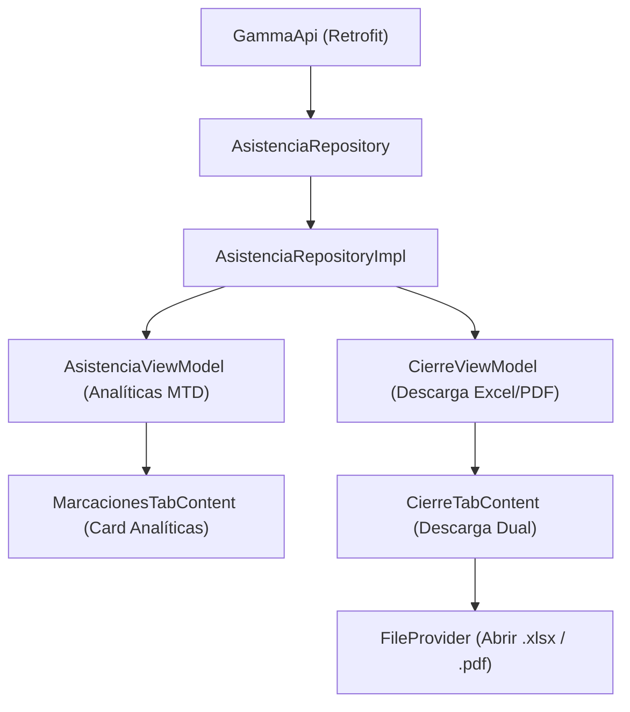

# Plan de Arquitectura y Diseño Técnico: Analíticas MTD y Reportes Duales

- **ID de Característica:** `analiticas-reportes-asistencia`
- **Fecha:** 28 de Octubre de 2026
- **Fase:** Fase 0 (Planificador)

---

## 1. Contratos de Datos y DTOs

### 1.1 Modelo de Períodos (`PeriodosModels.kt` / `AsistenciaModels.kt`)
```kotlin
data class PeriodosResponse(
    @SerializedName("periodo_laboral")
    val periodoLaboral: String,
    @SerializedName("periodo_contable")
    val periodoContable: String,
    @SerializedName("sincronizados")
    val sincronizados: Boolean
)
```

### 1.2 Modelo de Analíticas de Asistencia MTD
```kotlin
data class AnaliticasHorasResponse(
    @SerializedName("periodo")
    val periodo: String,
    @SerializedName("monto_por_hora")
    val montoPorHora: Int,
    @SerializedName("dias_trabajados")
    val diasTrabajados: Int,
    @SerializedName("total_horas_decimal")
    val totalHorasDecimal: Double,
    @SerializedName("total_horas_formato")
    val totalHorasFormato: String,
    @SerializedName("salario_acumulado_gs")
    val salarioAcumuladoGs: Long,
    @SerializedName("horas_perdidas_decimal")
    val horasPerdidasDecimal: Double,
    @SerializedName("horas_extras_decimal")
    val horasExtrasDecimal: Double,
    @SerializedName("balance_neto_decimal")
    val balanceNetoDecimal: Double,
    @SerializedName("horas_perdidas_formato")
    val horasPerdidasFormato: String,
    @SerializedName("horas_extras_formato")
    val horasExtrasFormato: String,
    @SerializedName("balance_neto_formato")
    val balanceNetoFormato: String,
    @SerializedName("promedio_horas_por_dia")
    val promedioHorasPorDia: Double
)
```

### 1.3 Estado UI de Analíticas (`AnaliticasUiState`)
```kotlin
sealed interface AnaliticasUiState {
    data object Loading : AnaliticasUiState
    data class Success(
        val analiticas: AnaliticasHorasResponse,
        val periodos: PeriodosResponse? = null
    ) : AnaliticasUiState
    data class Error(val message: String) : AnaliticasUiState
}
```

---

## 2. Definición de Endpoints en `GammaApi.kt`

```kotlin
// Endpoints en GammaApi.kt
@GET("asistencia/periodos")
suspend fun getPeriodos(): Response<PeriodosResponse>

@GET("asistencia/analiticas")
suspend fun getAnaliticas(
    @Query("hoja") hoja: String? = null
): Response<AnaliticasHorasResponse>

@retrofit2.http.Streaming
@GET("asistencia/reporte/excel")
suspend fun descargarReporteExcel(
    @Query("hoja") hoja: String? = null,
    @Query("descuento") descuento: Double = 0.0,
    @Query("saldo_anterior") saldoAnterior: Double = 0.0,
    @Query("incluir_iva") incluirIva: Boolean = true
): Response<okhttp3.ResponseBody>

@retrofit2.http.Streaming
@GET("asistencia/reporte/pdf")
suspend fun descargarReportePdfAsistencia(
    @Query("hoja") hoja: String? = null,
    @Query("descuento") descuento: Double = 0.0,
    @Query("saldo_anterior") saldoAnterior: Double = 0.0,
    @Query("incluir_iva") incluirIva: Boolean = true
): Response<okhttp3.ResponseBody>
```

---

## 3. Arquitectura Modular



### 3.1 Capa de Repositorio (`AsistenciaRepository`)
- Agregar métodos:
  - `suspend fun getPeriodos(): NetworkResult<PeriodosResponse>`
  - `suspend fun getAnaliticas(hoja: String? = null): NetworkResult<AnaliticasHorasResponse>`
  - `suspend fun descargarReporteExcel(hoja: String? = null, descuento: Double = 0.0, saldoAnterior: Double = 0.0, incluirIva: Boolean = true): NetworkResult<ByteArray>`
- Implementar en `AsistenciaRepositoryImpl` usando `safeApiCall`.

### 3.2 Capa de Presentación
1. **`AsistenciaViewModel`**:
   - Administra `analiticasState: StateFlow<AnaliticasUiState>`.
   - Método `cargarAnaliticas(hoja: String? = null)`.
   - Método `descargarExcel(context: Context, hoja: String? = null)`.
2. **`CierreViewModel`**:
   - Soporte para descargar archivo Excel en `CierreUiState.ExcelDownloaded(val fileBytes: ByteArray, val fileName: String)`.
3. **Manejo de Intent y Visualización de Archivos**:
   - Reutilización de `FileProvider` con tipos MIME:
     - `application/vnd.openxmlformats-officedocument.spreadsheetml.sheet` para `.xlsx`.
     - `application/pdf` para `.pdf`.

---

## 4. Manejo de Errores y Degradación Segura

- Si el endpoint de analíticas devuelve 400 (`ANALITICAS_ERROR` porque la hoja aún no tiene filas de marcación), se muestra un estado amigable indicando *"Sin registros computados en este período"*, sin romper el funcionamiento de las marcaciones laborales.
- Si no hay conexión o el servidor responde 500, se muestra un banner sutil con opción a reintentar.
