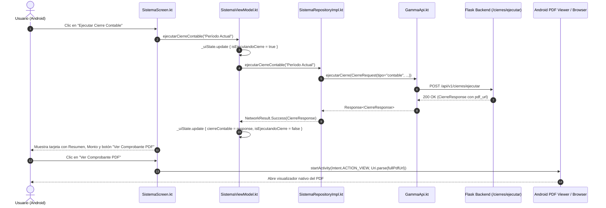

# Plan de Arquitectura y Contratos de Datos (Plan)
## Módulo: Visualización de Comprobante PDF de Cierre Contable Mensual en Gamma Mobile

- **Fecha:** 15 de Octubre de 2026
- **Versión de Plan:** 1.0.0
- **Fase:** 0 (Especificación y Arquitectura)

---

## 1. Arquitectura Modular



---

## 2. Contratos de Datos y Tipos

### 2.1 Request Payload (`POST /api/v1/cierres/ejecutar`)
```json
{
  "hoja": "Período Actual",
  "tipo": "contable",
  "aplicar_descuento": false
}
```

### 2.2 Response Payload
```json
{
  "resumen": "Cierre mensual contable (Libro Diario) completado para período Período Actual.",
  "pdf_url": "/api/v1/cierres/reportes/cierre_contable_período_actual.pdf",
  "total_horas": 0.0,
  "total_monto": 4500000,
  "tipo": "contable"
}
```

### 2.3 Resolución de URL Absoluta
En `SistemaViewModel`:
```kotlin
fun obtenerUrlAbsolutaPdf(pdfUrlRelativa: String?): String? {
    if (pdfUrlRelativa.isNullOrBlank()) return null
    if (pdfUrlRelativa.startsWith("http://") || pdfUrlRelativa.startsWith("https://")) {
        return pdfUrlRelativa
    }
    val base = _uiState.value.baseUrl.trimEnd('/')
    val relative = pdfUrlRelativa.trimStart('/')
    return "$base/$relative"
}
```

---

## 3. Manejo de Errores y Tolerancia a Fallos

1. **Fallo de Conexión o Backend Inaccesible:**
   - Si la llamada a la API falla (código 400, 500 o timeout de red), se actualiza `cierreMensaje` con el detalle del error y `isEjecutandoCierre = false`. La interfaz permanece interactiva sin cerrar la app.
2. **Intent sin Aplicación PDF Instalada:**
   - Se protege el despacho de `startActivity` con bloque `try/catch (e: ActivityNotFoundException)` para mostrar un Toast descriptivo si el dispositivo carece de navegador o visor compatible.
