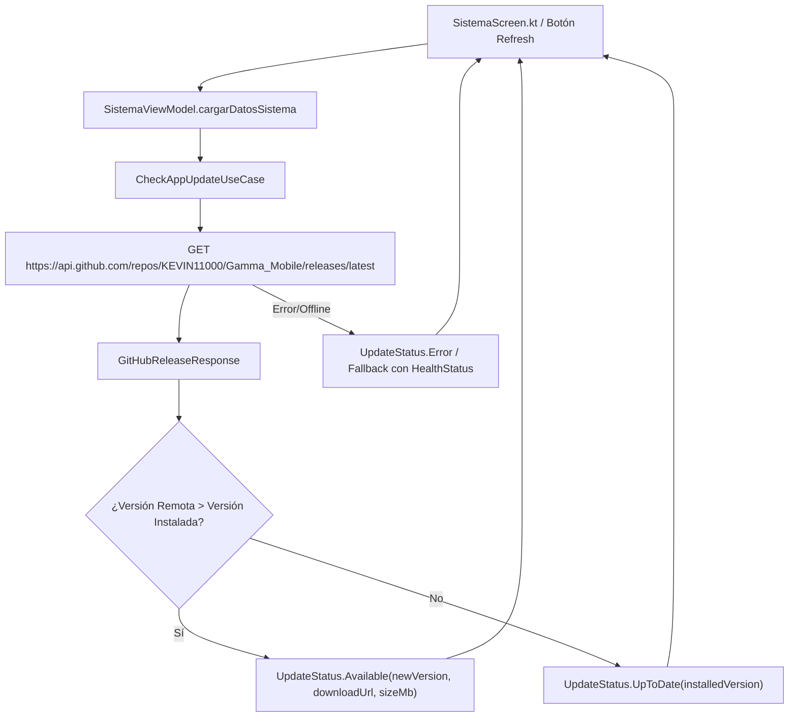

# Plan de Arquitectura y Diseño — Verificación de Actualizaciones vía GitHub Releases

## 1. Arquitectura de Flujo



---

## 2. Contratos de Datos y Componentes

### 2.1. Modelo Remoto (GitHub Release DTO)
```kotlin
data class GitHubReleaseDto(
    @SerializedName("tag_name") val tagName: String = "",
    @SerializedName("name") val name: String = "",
    @SerializedName("body") val body: String = "",
    @SerializedName("assets") val assets: List<GitHubAssetDto> = emptyList()
)

data class GitHubAssetDto(
    @SerializedName("name") val name: String = "",
    @SerializedName("size") val size: Long = 0L,
    @SerializedName("browser_download_url") val browserDownloadUrl: String = ""
)
```

### 2.2. Estado de Dominio (`UpdateInfo`)
```kotlin
sealed class UpdateStatus {
    object Idle : UpdateStatus()
    data class UpToDate(val version: String) : UpdateStatus()
    data class UpdateAvailable(
        val version: String,
        val downloadUrl: String,
        val assetName: String,
        val sizeMb: Double
    ) : UpdateStatus()
    data class CheckFailed(val reason: String?) : UpdateStatus()
}
```

### 2.3. Comparador Semántico de Versiones (`SemverComparator`)
- Extrae números de `major.minor.patch` descartando prefijos `v` y metadatos de commit `+hash`.
- Ejemplo: `"0.0.5"` > `"0.0.4+6bb982e"` -> `true`.
- Ejemplo: `"0.0.4"` vs `"0.0.4"` -> `false` (UpToDate).

---

## 3. Integración en `SistemaViewModel` y `SistemaScreen`

- `SistemaUiState`:
  ```kotlin
  val updateStatus: UpdateStatus = UpdateStatus.Idle
  ```
- En `cargarDatosSistema()`:
  - Se ejecuta en paralelo la llamada a `CheckAppUpdateUseCase`.
  - Se actualiza `updateStatus` reactivamente en `_uiState`.
- En `SistemaScreen.kt`:
  - En la tarjeta "Versión de la Aplicación", se renderiza según `updateStatus`:
    - Si `UpdateAvailable`: Tarjeta con icono llamativo, versión nueva, tamaño del APK y botón de descarga directa.
    - Si `UpToDate`: Chip o mensaje verde con icono de `CheckCircle` confirmando que el dispositivo cuenta con la última versión.

---

## 4. Estrategia de Pruebas Unitarias
- `SemverComparatorTest`:
  - `"0.0.5"` > `"0.0.4"` -> true.
  - `"0.0.4"` == `"0.0.4+abc"` -> equal.
  - `"0.1.0"` > `"0.0.9"` -> true.
  - `"v0.0.4"` normalizado a `"0.0.4"`.
- `SistemaViewModelTest`:
  - Simulación de respuesta GitHub con versión mayor -> Estado `UpdateAvailable`.
  - Simulación de respuesta GitHub con versión igual -> Estado `UpToDate`.
  - Simulación de fallo de red -> No rompe la carga del resto de datos del sistema.
