# Plan de Arquitectura y Diseño Técnico (Plan)
## Módulo: Sincronización Salarial, Cierre Contable y Sincronización de Tickets GitHub

- **Fecha:** 15 de Octubre de 2026
- **Versión de Plan:** 1.0.0
- **Fase:** 0 (Especificación y Arquitectura)

---

## 1. Arquitectura Modular

```mermaid
flowchart TD
    subgraph Registro_Ingreso ["1. Flujo Salarial Reactivo"]
        A[Movimiento Registrado: Libro_Diario] --> B{¿Es Ingreso y Salario/Sueldo?}
        B -->|Sí| C[SheetsRepository.upsert_salario_presupuesto_base]
        C --> D[(Hoja: Presupuesto_Base)]
        B -->|No| E[Continuar flujo normal]
    end

    subgraph Cierre_Contable ["2. Validación y Corte Mensual"]
        F[execute_monthly_closing] --> G[Validar Balance y Consistencia]
        G -->|Inconsistente| H[Abortar y alertar sin alterar Libro_Diario]
        G -->|Válido| I[Generar Backup CSV y Drive]
        I --> J[(Hoja: Cierres_Historicos)]
        J --> K[Resetear Libro_Diario con Saldo Inicial]
    end

    subgraph Tickets_GitHub ["3. Sincronización Bidireccional Tickets"]
        L[PATCH /api/v1/soporte/tickets] --> M[Actualizar tickets.json]
        M --> N{¿Tiene issue_url o GITHUB_TOKEN?}
        N -->|Sí| O[GitHubIssueSyncService.sync_ticket_state]
        O --> P[GitHub Issues API: Cerrar / Comentar]
    end
```



---

## 2. Contratos de Datos y Esquemas

### 2.1 Esquema para Presupuesto Base (Upsert Salarial)
```python
# Ubicación: Gamma_bot/src/repositories/sheets_repository.py
class SheetsRepository:
    def upsert_salario_presupuesto_base(self, nuevo_salario: int) -> bool:
        """
        Busca si existe una fila en Presupuesto_Base donde Categoria o Concepto
        contenga 'Salario' o 'Sueldo'.
        - Si existe: Actualiza 'Monto_Mensual_Gs' con nuevo_salario.
        - Si no existe: Inserta nueva fila con encabezados canónicos:
          [Tipo_Flujo="Ingreso Fijo", Categoria="Salario", Concepto="Sueldo Mensual",
           Monto_Mensual_Gs=str(nuevo_salario), Tipo_Ingreso_Gasto="Fijo", Observaciones="Auto"]
        """
```

### 2.2 Validación de Balance para Cierre Contable
```python
# Ubicación: Gamma_bot/src/logic/financiero.py
class BalanceValidationResult:
    is_valid: bool
    total_ingresos: int
    total_gastos: int
    margen_neto: int
    discrepancia: int
    error_message: str | None
```

### 2.3 Contrato de Sincronización de Tickets (GitHub)
```python
# Ubicación: Gamma_bot/src/services/github_service.py
class GitHubIssueSyncService:
    @staticmethod
    def sync_ticket_to_github(ticket_id: str, estado: str, resolucion: str | None) -> bool:
        """
        Consume GITHUB_TOKEN del entorno. Si está presente, actualiza el issue
        asociado al ticket en KEVIN11000/Gamma_Mobile marcándolo como closed/open
        y agregando la nota de resolución.
        """
```

---

## 3. Manejo de Errores y Tolerancia a Fallos

1. **Fallo en API de Google Sheets durante Upsert Salarial:**
   - La inserción o actualización salarial en `Presupuesto_Base` no debe abortar la inserción principal del movimiento en `Libro_Diario`. Se captura en bloque `try/except` y se registra en log con nivel `WARNING`.
2. **Fallo durante Cierre Contable:**
   - Si la validación de balance falla o la subida a Drive devuelve error, el método lanza `ValueError` con el detalle explícito y **no ejecuta** `ws.clear()` en `Libro_Diario`.
3. **Fallo de Conectividad con GitHub:**
   - Si la API de GitHub responde con rate limit, timeout o error 5xx, el ticket se actualiza localmente en `tickets.json` marcando una bandera `sync_pending: true` para reintentos posteriores.
