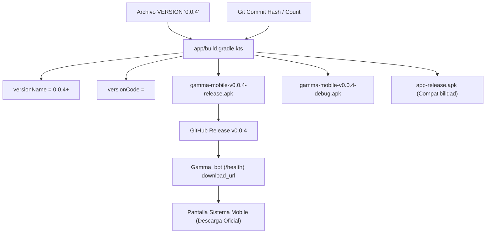

# Plan de Arquitectura e Implementación — Versionado de Distribuibles (v0.0.4)

## 1. Arquitectura de Versionado



## 2. Cambios por Módulo

### 2.1. Raíz del Repositorio `GammaMobile`
- Archivo `VERSION`: Contiene la cadena simple `0.0.4`.

### 2.2. Gradle (`app/build.gradle.kts`)
- Función auxiliar `getAppVersion()`:
  ```kotlin
  fun getAppVersion(): String {
      val versionFile = rootProject.file("VERSION")
      return if (versionFile.exists()) {
          versionFile.readText().trim()
      } else {
          "0.0.4"
      }
  }
  ```
- `defaultConfig`:
  ```kotlin
  val appVersion = getAppVersion()
  versionName = "$appVersion+${getGitCommitHash()}"
  ```
- Configuración de salidas en `android { ... }`:
  ```kotlin
  applicationVariants.all {
      val variant = this
      outputs.all {
          val output = this as? com.android.build.gradle.internal.api.BaseVariantOutputImpl
          output?.outputFileName = "gamma-mobile-v${appVersion}-${variant.name}.apk"
      }
  }
  ```
- Tarea Gradle complementaria o paso de compatibilidad para asegurar copia a `app-${variant.name}.apk`.

### 2.3. Mobile UI (`SistemaScreen.kt`)
- Actualizar fallback de visualización:
  `"Versión instalada: ${uiState.appVersion.ifEmpty { "0.0.4+debug" }}"`

### 2.4. Backend (`Gamma_bot/src/api/blueprint.py`)
- Endpoint `GET /health`:
  ```python
  "latest_app_version": "0.0.4",
  "latest_app_version_code": 29,
  "download_url": "https://github.com/KEVIN11000/Gamma_Mobile/releases/download/v0.0.4/gamma-mobile-v0.0.4-release.apk",
  ```

---

## 3. Plan de Verificación y Pruebas
1. Compilar `./gradlew assembleDebug` y verificar que genere `gamma-mobile-v0.0.4-debug.apk`.
2. Compilar `./gradlew assembleRelease` y verificar que genere `gamma-mobile-v0.0.4-release.apk` firmado.
3. Ejecutar `./gradlew testDebugUnitTest` para asegurar que ningún test unitario haya sido afectado.
4. Ejecutar `pytest tests/test_mobile_api.py` en `Gamma_bot` para validar los contratos de API y salud.
