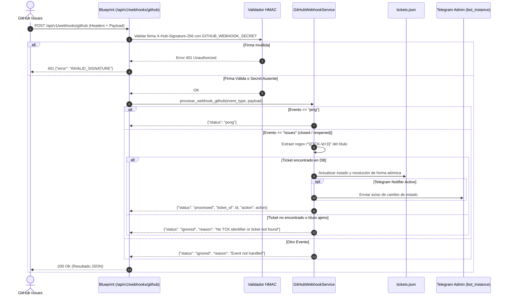

# Plan de Arquitectura y Contratos de Datos (Plan)
## Módulo: Receptor Webhook GitHub Issues para Sincronización Reactiva de Tickets

- **Fecha:** 15 de Octubre de 2026
- **Versión de Plan:** 1.0.0
- **Fase:** 0 (Especificación y Arquitectura)

---

## 1. Arquitectura Modular

El receptor se integrará de forma modular y desacoplada dentro del backend `Gamma_bot`:



### Componentes Involucrados:
1. **`src/services/github_service.py` (`GitHubWebhookService`):**
   - Encapsula la lógica de verificación de firma (`verify_signature(payload_bytes, signature_header, secret)`).
   - Encapsula el procesamiento semántico del evento (`process_github_event(event_type, payload)`).
   - Abstrae el parseo de regex para IDs de tickets (`extract_ticket_id(title)`).
2. **`src/api/blueprint.py` (Ruta HTTP):**
   - Define `@mobile_api.route("/webhooks/github", methods=["POST"])`.
   - **Nota de seguridad y arquitectura:** Esta ruta **NO** lleva el decorador `@require_api_key`, ya que GitHub no utiliza API Keys en cabeceras de sus webhooks, sino la firma criptográfica HMAC en `X-Hub-Signature-256`.
3. **`src/data/tickets.json` (Persistencia):**
   - Actualización en memoria y serialización limpia (`json.dump(..., indent=2, ensure_ascii=False)`).

---

## 2. Contratos de Datos y Esquemas

### 2.1 Encabezados HTTP de Entrada
| Header | Tipo | Requerido | Descripción |
|---|---|---|---|
| `X-GitHub-Event` | `string` | Sí | Nombre del evento (`ping`, `issues`, etc.). |
| `X-Hub-Signature-256` | `string` | Condicional | Firma HMAC en formato `sha256=<hex_digest>`. Requerido si `GITHUB_WEBHOOK_SECRET` está seteado. |
| `Content-Type` | `string` | Sí | `application/json`. |

### 2.2 Estructura del Payload de Entrada (`issues`)
```json
{
  "action": "closed",
  "issue": {
    "number": 12,
    "title": "[TCK-006] Despliegue y recarga de worker en PythonAnywhere",
    "state": "closed",
    "state_reason": "completed",
    "html_url": "https://github.com/KEVIN11000/Gamma_Mobile/issues/12",
    "closed_at": "2026-10-15T15:30:00Z"
  },
  "sender": {
    "login": "KEVIN11000"
  }
}
```

### 2.3 Contratos de Respuesta HTTP
#### A. Ping exitoso (`200 OK`)
```json
{
  "status": "pong",
  "message": "GitHub Webhook listener operational"
}
```

#### B. Evento procesado (`200 OK`)
```json
{
  "status": "processed",
  "ticket_id": "TCK-006",
  "action": "closed",
  "nuevo_estado": "Cerrado",
  "issue_number": 12
}
```

#### C. Evento ignorado sin error (`200 OK`)
```json
{
  "status": "ignored",
  "reason": "No TCK identifier found in issue title '[DOC] Update README'"
}
```

#### D. Firma inválida (`401 Unauthorized`)
```json
{
  "error": {
    "code": "INVALID_SIGNATURE",
    "message": "Firma HMAC de GitHub no coincide con el secret configurado"
  }
}
```

---

## 3. Seguridad y Validación Criptográfica

Para la verificación de firma se implementa el algoritmo estándar de GitHub Webhooks:

```python
import hmac
import hashlib

def verify_signature(payload_bytes: bytes, signature_header: str | None, secret: str | None) -> bool:
    if not secret:
        return True  # Modo permisivo si no hay secret configurado en entorno local
    if not signature_header or not signature_header.startswith("sha256="):
        return False
    
    expected_mac = hmac.new(secret.encode("utf-8"), payload_bytes, hashlib.sha256).hexdigest()
    expected_header = f"sha256={expected_mac}"
    return hmac.compare_digest(expected_header, signature_header)
```

---

## 4. Manejo de Fallos y Resiliencia

1. **GitHub Retry Policy:** Si el backend responde con códigos de error 5xx, GitHub reintentará el webhook periódicamente. Por lo tanto, eventos con tickets inexistentes o payloads sin formato TCK deben devolver **`200 OK` con `"status": "ignored"`**, nunca códigos 4xx/5xx de bloqueo.
2. **Fallos de Notificación a Telegram:** La notificación a Telegram mediante `bot_instance` se ejecuta en bloque `try/except` no bloqueante; si la API de Telegram falla o hay timeout de red, el ticket igualmente se actualiza y la respuesta a GitHub sigue siendo `200 OK`.
3. **Escritura Atómica:** La escritura en `tickets.json` se realiza de manera segura verificando la existencia del directorio y asegurando codificación UTF-8.

---

## 5. Estrategia de Pruebas Unitarias

Se desarrollará el archivo `Gamma_bot/tests/test_github_webhook.py` con fixtures aislados:
- **`mock_tickets_file`:** Redirige la ruta `TICKETS_FILE` a un directorio temporal `tmp_path` conteniendo una muestra controlada de tickets (`TCK-001`, `TCK-006`).
- **Casos de prueba:**
  1. `test_webhook_ping_response`: Verifica que `X-GitHub-Event: ping` devuelva `200 OK` y `"status": "pong"`.
  2. `test_webhook_issue_closed_updates_ticket`: Simula payload de GitHub con `action: closed` y valida que el estado pase a `"Cerrado"` en el archivo temporal.
  3. `test_webhook_issue_reopened_updates_ticket`: Simula payload con `action: reopened` y valida que el estado vuelva a `"Abierto"`.
  4. `test_webhook_hmac_valid_and_invalid`: Valida aceptación con HMAC correcto y rechazo 401 ante firmas corruptas cuando `GITHUB_WEBHOOK_SECRET` está activo.
  5. `test_webhook_ignored_events`: Valida respuesta 200 `"ignored"` para issues ajenos a TCK o eventos no soportados.
